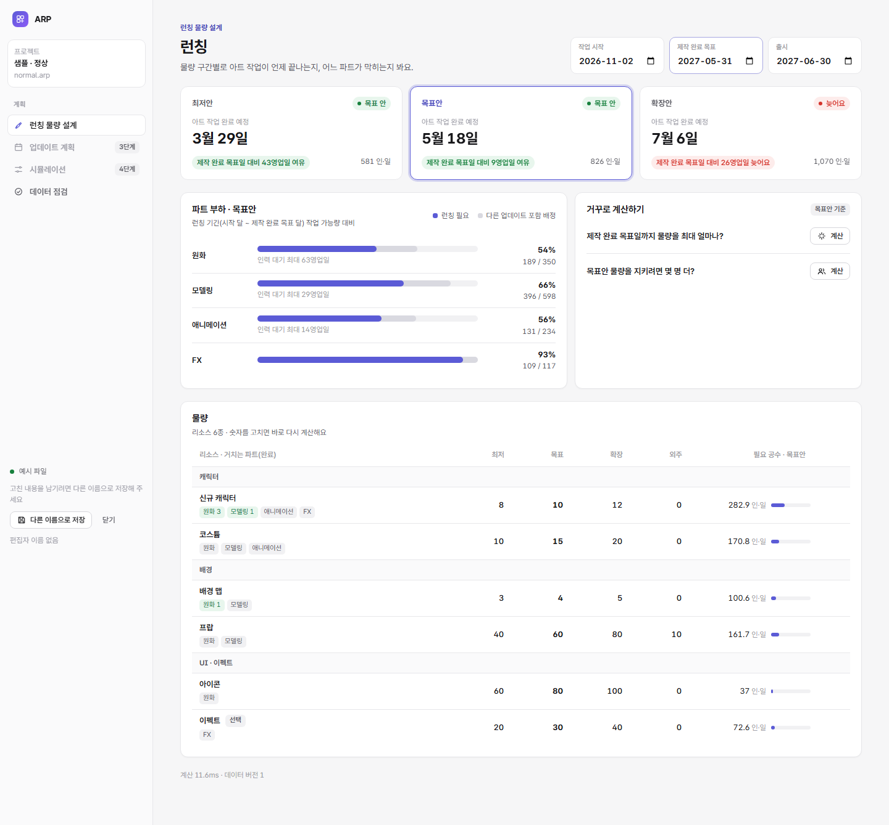
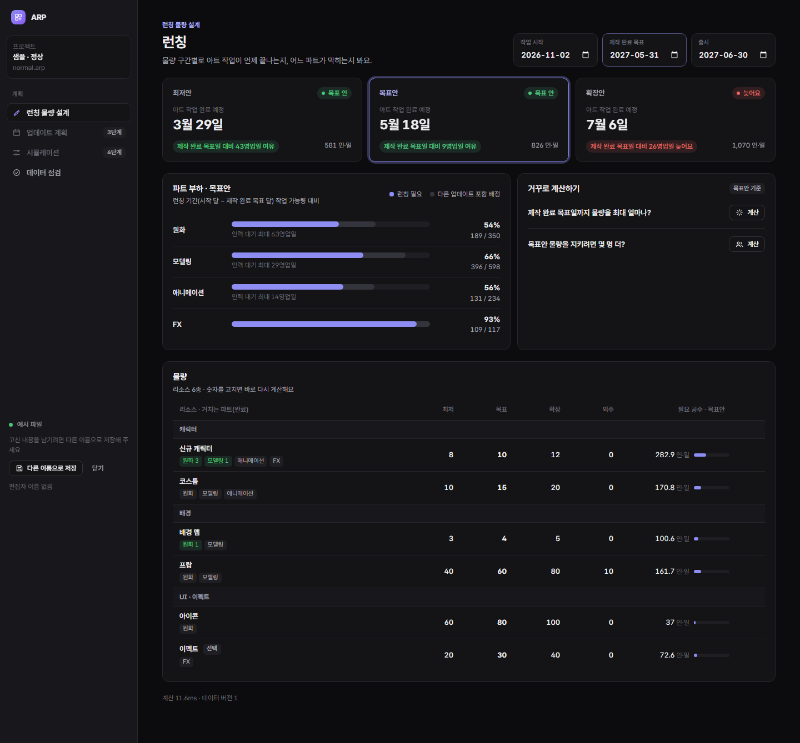
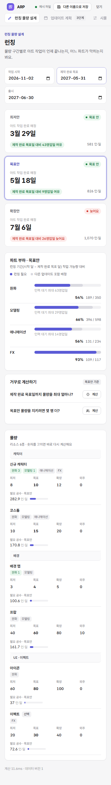
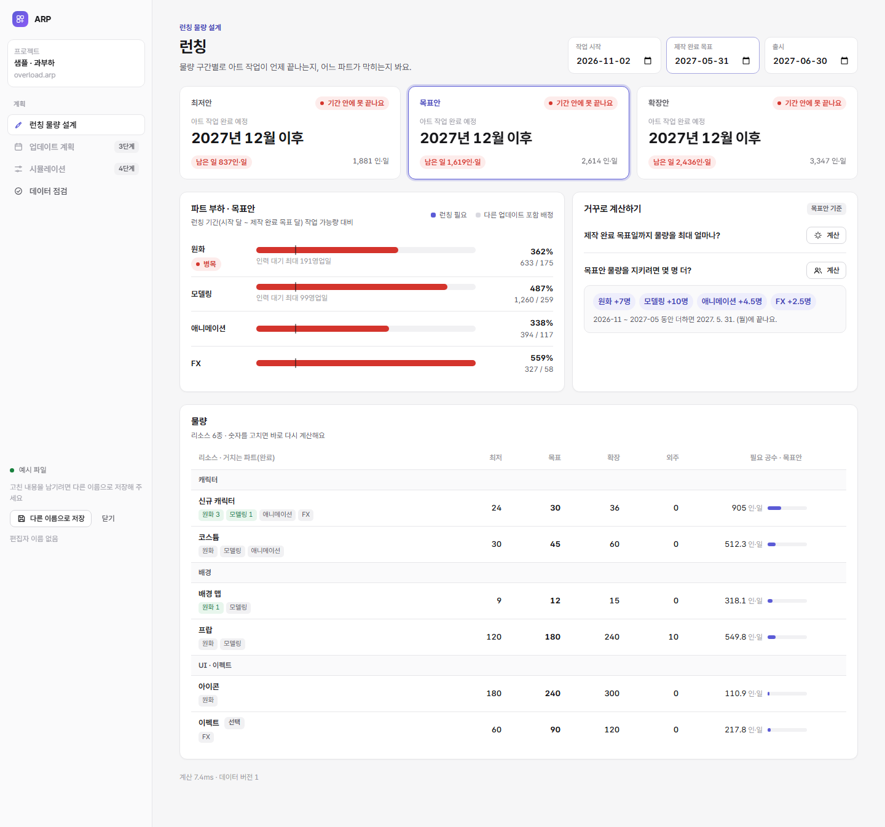
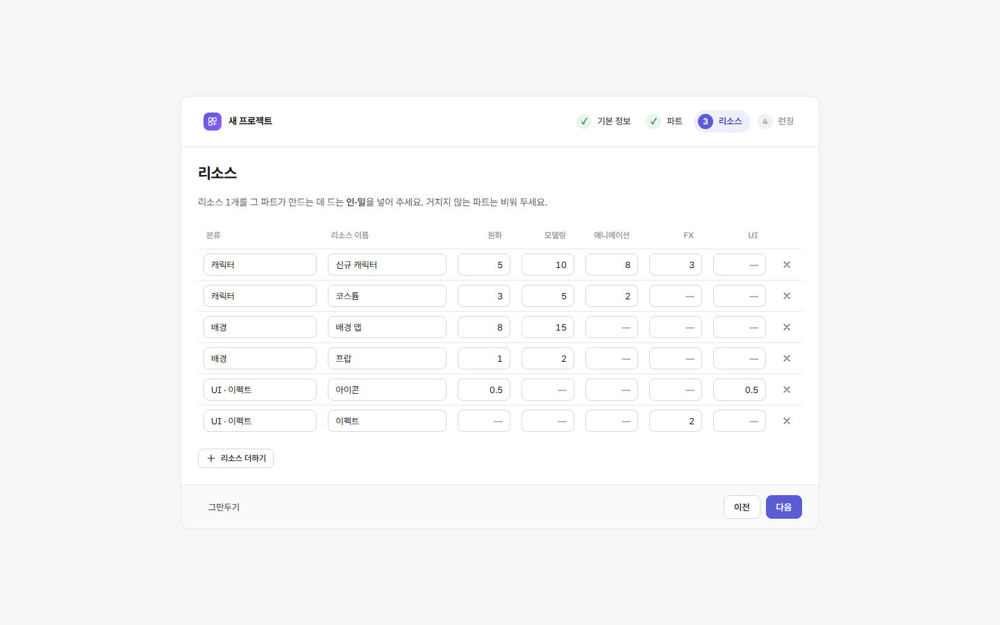

# 2단계: 런칭 물량 설계 화면

```bash
npm run dev        # 개발 서버 → http://localhost:5173/app/index.html (예시: ?sample=normal)
npm run capture    # 화면 캡처 8장 (samples/out/shots)
npm run e2e        # 저장 흐름 시험 6개 + 새 프로젝트 만들기 시험 8개
```

## 화면 구성

| 영역 | 하는 일 |
|---|---|
| 날짜 칩 | 작업 시작 · 제작 완료 목표 · 출시를 바로 고친다 |
| 구간 카드 3장 | 최저안·목표안·확장안마다 아트 작업 완료 예정일, 판정, 제작 완료 목표일 대비 여유·지연(영업일), 필요 공수. 누르면 아래가 그 구간 기준으로 바뀐다 |
| 파트 부하 | 런칭 기간(시작 달 ~ 제작 완료 목표 달) 작업 가능량 대비 런칭 필요 공수, 다른 업데이트를 포함한 배정, 인력 대기, 병목 표시. 100%를 넘으면 눈금을 줄이고 100% 선을 그린다 |
| 거꾸로 계산하기 | ① 제작 완료 목표일까지 물량을 최대 얼마나(모든 리소스를 같은 비율로) ② 이 물량을 지키려면 파트별로 몇 명 더(0.5명 단위). 물량·날짜·구간이 바뀌면 흐리게 표시하고 다시 계산하게 한다 |
| 물량 표 | 분류별 묶음, 거치는 파트와 완료 수량, 최저·목표·확장·외주를 칸 안에서 바로 고친다(Enter·칸 벗어나기 = 반영, Esc = 되돌리기). 리소스 더하기·빼기. 규칙 위반 줄은 빨갛게, 이유를 줄 아래에 |
| 데이터 점검 | 검증 오류·주의 목록. 오류가 있으면 계산하지 않고 배너로 알린다 |



## 디자인 기준 (새로 정함)

| 항목 | 기준 |
|---|---|
| 글꼴 | Pretendard Variable (OFL, 패키지로 포함 · 필요한 글자만 내려받음) |
| 색 | 무채색 바탕 + 강조색 하나(남보라 `#5b5bd6`). 상태는 초록·주황·빨강 세 가지만, 옅은 바탕 + 진한 글자 |
| 선·모서리 | 1px 얇은 선, 카드 12px · 버튼 8px 둥근 모서리, 그림자는 거의 없음 |
| 글자 크기 | 11 · 12 · 13 · 14 · 15 · 20 · 24 · 26 |
| 숫자 | 자릿수 맞춤(`tabular-nums`), 오른쪽 정렬, 천 단위 쉼표 |
| 날짜 | `2027. 5. 31.(월)`, 카드는 `5월 31일` |
| 배지 | 점이 있는 알약 모양 |
| 입력 | 표 칸은 평소엔 글자처럼, 올리면 테두리, 누르면 강조색 테두리 |
| 안내문 | 해요체 |
| 다크 모드 | 시스템 설정을 따름(`?theme=dark`로 강제 가능) |
| 좁은 화면 | 860px 아래: 옆 메뉴가 위 띠로. 640px 아래: 물량 표가 줄마다 카드 |

 

## 구조

```
화면 스레드 (Preact)                계산 스레드 (Web Worker)
web/app/App.tsx  ── 메시지 ──▶  web/app/worker.ts
  파일 열기·저장, 자동 저장          SQLite(WebAssembly) 메모리 DB
  편집 중 표시, 충돌 확인            core/pipeline.ts  ProjectSession (고친 표만 다시 읽기)
web/app/ui/*  화면                   core/launch.ts    요약 · 고치기(변경 이력) · 구간 비교 · 역산
                                     engine/           일정 계산
```

- 계산이 화면 스레드를 막지 않는다.
- 파일 바이트는 저장할 때만 화면 스레드로 넘어온다(전송, 복사 없음).

## 저장

- 크롬·엣지: 연 파일에 바로 저장한다. 고친 뒤 2초 동안 더 고치지 않으면 자동 저장하고, Ctrl+S로 바로 저장할 수도 있다.
- 그 밖의 브라우저와 예시 파일: 다른 이름으로 저장(다운로드).
- 편집 중 표시: 열 때 이름과 시각을 파일에 적고 5분마다 갱신한다. 다른 사람이 30분 안에 갱신한 표시가 있으면 읽기 전용으로 연다. 닫기를 누르면 지운다.
- 저장 전 확인: 연 뒤 파일이 다른 곳에서 바뀌었으면 덮어쓰지 않고 충돌로 알린다.
- 경쟁 상태 처리:
  - 저장을 시작한 뒤 고친 내용이 있으면 "저장 대기"를 유지하고 다시 저장한다.
  - 저장 중에 들어온 저장 요청은 끝난 뒤 이어서 한다.

**시험(`npm run e2e`):** 화면 없는 크롬은 파일 선택 창을 쓸 수 없다. 그래서 브라우저 개인 저장소(OPFS)의 파일 핸들로 같은 흐름을 시험한다(`?sample=normal&opfs=1`).

| 시험 | 결과 |
|---|---|
| 열 때 편집 중 표시 저장 | 통과 |
| 고치면 저장 대기 | 통과 |
| 약 2초 뒤 자동 저장 | 통과 |
| 다시 열면 고친 값 유지 | 통과 |
| 다른 곳에서 바뀌면 저장 거부 | 통과 |
| 다른 사람이 편집 중이면 읽기 전용 | 통과 |

## 역산 방식

**최대 물량:**
- 런칭 물량(선택 구간)에 같은 비율 k를 곱한다.
- 제작 완료 목표일(없으면 출시일) 안에 끝나는 가장 큰 k를 0.01 단위로 찾는다.
- 지금 맞으면 두 배씩 늘려 상한을 찾고, 그다음 이분 탐색한다.

**필요 인원:**
1. 런칭 기간 동안 모든 파트에 같은 인원 x를 더해, 맞는 가장 작은 x를 찾는다.
2. 공정 순서대로 파트마다 더한 인원을 맞는 데까지 줄인다.
- 단위는 0.5명이다.
- 과부하 샘플에서 31번 계산(18ms)으로 답이 나왔다: 원화 +7, 모델링 +10, 애니메이션 +4.5, FX +2.5명.
- **처음 방식:** 늦게 만드는 파트에 0.5명씩 더했다. 그런데 앞 공정에 막힌 파트를 계속 골라 수렴하지 않았다. 그래서 위 방식으로 바꾸고, 엔진의 근거 선택도 고쳤다.

**엔진 근거 선택 고침:**
- 못 끝낸 업데이트: "준비됐는데 인력이 모자라 가장 오래 기다린 스테이지"를 근거로 고른다.
- 완료 제약 때문에 늦은 경우: 실제로 늦게 만든 앞 공정으로 거슬러 간다.



## 새 프로젝트 만들기

시작 화면 → **새 프로젝트 만들기** → 4단계 마법사([`web/app/ui/NewProject.tsx`](../web/app/ui/NewProject.tsx), 로직 [`core/new-project.ts`](../core/new-project.ts)).

| 단계 | 넣는 것 | 기본값 |
|---|---|---|
| 기본 정보 | 이름, 계획 기간(달), 근무 요일, 여유율, 휴일 | 다음 달부터 24개월, 월–금, 10%, 날짜가 고정된 공휴일 |
| 파트 | 공정 순서대로 이름·인원·가동률. 순서 바꾸기·더하기·빼기 | 원화 3 · 모델링 4 · 애니메이션 2 · FX 1명, 80% |
| 리소스 | 분류, 이름, 파트별 1개당 공수(비우면 거치지 않음) | 신규 캐릭터, 코스튬, 배경 맵, 프랍, 아이콘, 이펙트 |
| 런칭 | 이름, 작업 시작·제작 완료 목표·출시일(끄면 런칭 없이) | 계획 시작일, 8개월 뒤 말일, 9개월 뒤 말일 |

- **다음으로 넘어갈 때:** 그 단계의 문제를 사람이 고칠 수 있는 말로 보여 주고 머문다. 예: "출시일이 계획 기간 뒤예요. 계획 기간을 늘려 주세요."
- **만들기를 누르면:**
  1. 메모리에 새 파일을 만들고 편집 중 표시를 쓴다.
  2. 저장 위치 고르기 창을 연다.
  3. 런칭 물량 설계 화면을 연다. 물량은 처음엔 모두 0이다.
- **저장 위치를 고르지 않으면:** "저장 안 된 변경 있음"으로 열고, 다른 이름으로 저장하게 안내한다.
- **ID:** P01, G01, R001처럼 순서대로 만든다. 이름은 나중에 바꿔도 ID는 그대로다.
- **휴일:** 설·추석·대체 공휴일은 해마다 날짜가 달라 직접 넣는다. 회사 휴무일 칸이 있다.



**시험(`tools/e2e-new.mjs`, 8개 통과):** 이름이 비면 머문다 · 파트를 더하면 리소스 공수 칸이 생긴다 · 만들면 런칭 화면이 열린다 · 리소스 6종 · 파일 저장 · 거치는 파트 반영 · 물량을 넣으면 완료 예정일. 검사(`test/new-project.test.mjs`) 4개.

## 남은 일 (2단계 안)

- 실제 브라우저 파일(공유 드라이브)로 저장·충돌 확인(사람이 직접)
- 편집 중 표시는 탭을 그냥 닫으면 지워지지 않는다(30분 뒤 풀림). 필요하면 닫을 때 지우는 방법을 더 찾는다
