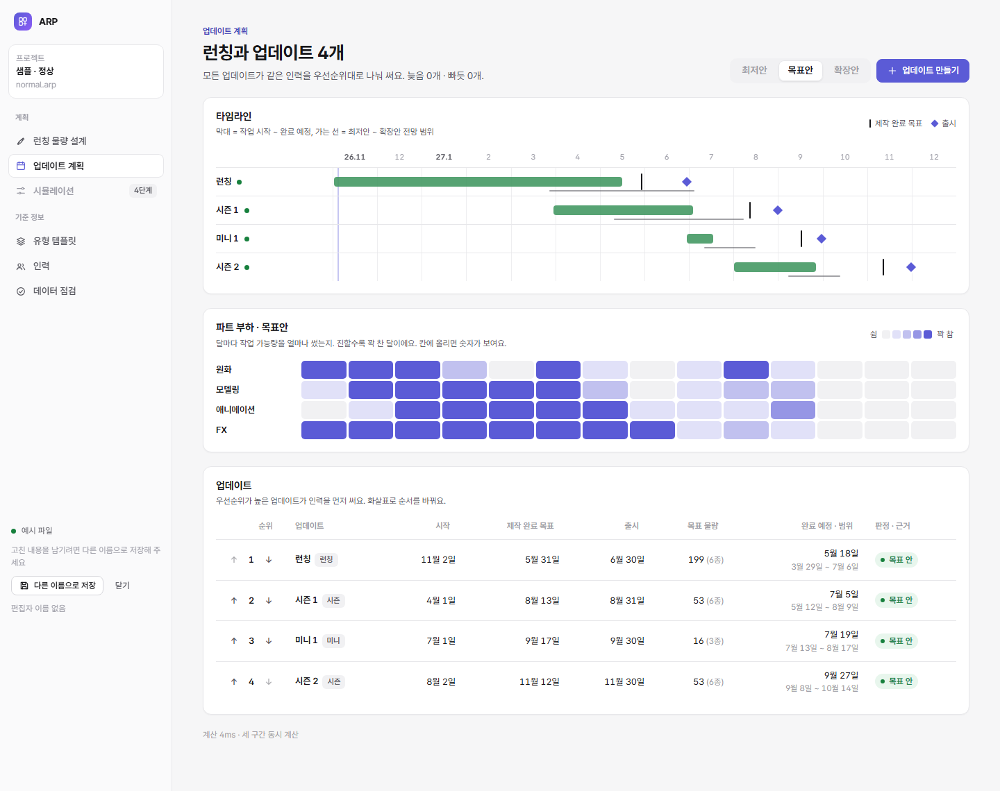
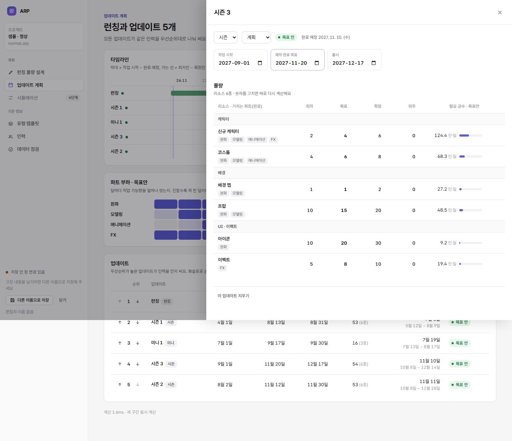
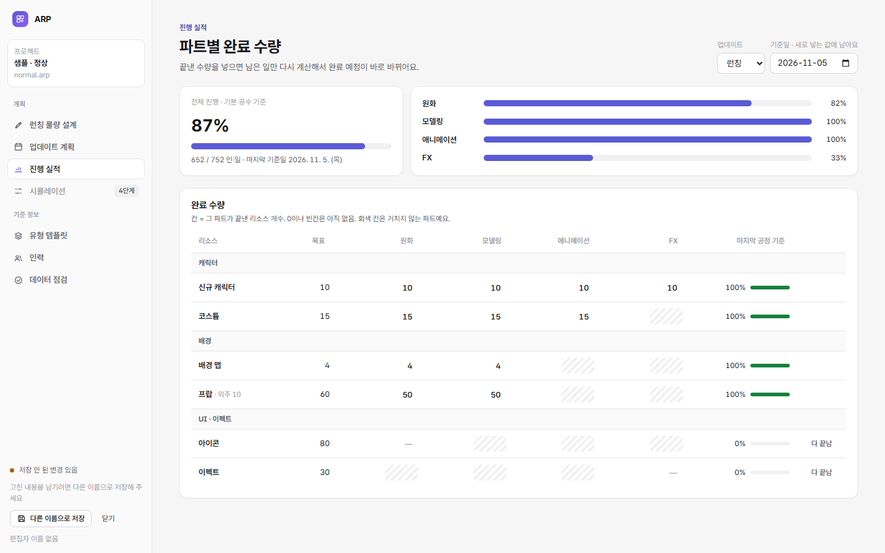
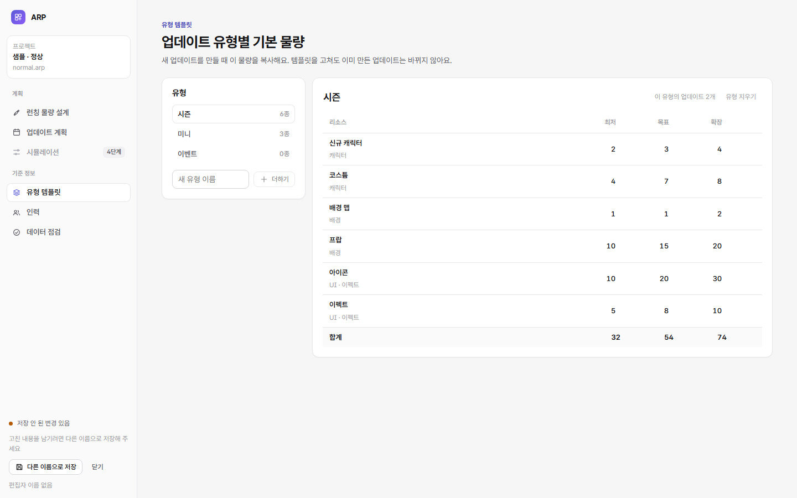
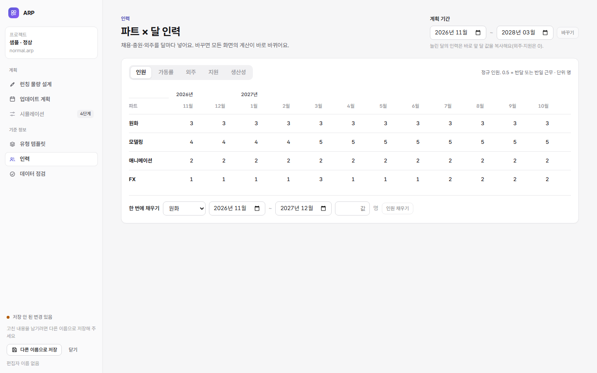

# 3단계: 업데이트 계획 · 유형 템플릿 · 인력

```bash
npm run dev     # → /app/index.html?sample=normal&page=plan  (page = launch | plan | progress | templates | capacity | check)
npm run e2e     # 저장 6 + 새 프로젝트 8 + 업데이트 계획 14 + 진행 실적 5
```

## 화면

### 업데이트 계획



| 영역 | 하는 일 |
|---|---|
| 구간 바꾸기 | 최저안 · 목표안 · 확장안. 런칭 화면과 같은 값을 쓴다 |
| 타임라인 | 업데이트마다 작업 시작부터 완료 예정까지 막대. 색은 판정(초록·주황·빨강). 아래 가는 선은 최저안~확장안 완료 예정 범위(전망). 세로선은 제작 완료 목표, 마름모는 출시, 옅은 남보라 선은 오늘. 누르면 상세가 열린다 |
| 파트 부하 지도 | 파트 × 달 가동 비율(배정 ÷ 작업 가능량)을 남보라 진하기로. 빨강은 "늦음"에만 쓰므로 여기서는 쓰지 않는다. 칸에 올리면 숫자가 보인다 |
| 업데이트 목록 | 순위(화살표로 바꾸기), 유형, 날짜, 목표 물량, 완료 예정과 범위, 판정과 근거(파트 · 리소스). 완료·취소 업데이트는 맨 아래 흐리게 |
| 업데이트 만들기 | 이름 · 유형 · 날짜. 그 유형 템플릿의 물량을 복사하고 우선순위는 맨 뒤 |
| 상세(옆 패널) | 이름, 유형, 상태(계획·진행 중·완료·취소), 날짜, 물량 표(런칭과 같은 표), 지우기(두 번 확인) |



### 진행 실적



- 업데이트를 고르면 리소스 × 파트 표가 나온다. 칸에 그 파트가 끝낸 개수를 넣는다. 거치지 않는 파트는 빗금 칸이다.
- 기준일을 정하면 새로 넣는 값에 함께 남는다(기본은 오늘).
- **다 끝남:** 거치는 모든 파트를 (목표 − 외주)만큼 완료로 넣는다.
- 0과 빈칸은 같은 뜻이고, 실적 행을 지운다.
- **진행률:** 기본 공수로 바꾼 인·일 기준이다. 전체와 파트별, 그리고 리소스마다 마지막 공정 기준으로 보여준다.
- **주황 칸:** 앞 공정보다 많이 끝냈거나 확장 물량을 넘긴 칸이다. 칸에 올리면 이유가 보인다. 계산은 그대로 한다.
- 넣은 실적은 남은 일 계산에 바로 반영된다. 예: 정상 예시에서 4종을 다 끝남으로 넣으면 런칭 완료 예정이 5월 18일 → 3월 11일.

### 유형 템플릿



- **유형:** 더하기, 이름 바꾸기, 지우기. 쓰는 업데이트가 있거나 런칭 유형이면 지울 수 없다.
- **템플릿 물량:** 리소스를 더하거나 빼고, 최저·목표·확장을 고친다. 합계 줄이 있다.
- 템플릿을 고쳐도 이미 만든 업데이트는 바뀌지 않는다(복사 방식).

### 인력



- 파트 × 달 표에서 항목(인원 · 가동률 · 외주 · 지원 · 생산성)을 골라 칸마다 고친다.
- **한 번에 채우기:** 파트, 기간, 값을 정해 한꺼번에 넣는다. 예: 7월부터 FX 2명.
- **계획 기간 바꾸기:**
  - 새로 들어온 달의 인력은 가장 가까운 앞 달 값을 복사한다. 외주·지원은 0으로 둔다.
  - 기간을 줄여도 기간 밖 행은 지우지 않는다. 그래서 다시 늘리면 값이 그대로 돌아온다.

## 로직

| 파일 | 내용 |
|---|---|
| [core/edits.ts](../core/edits.ts) | 모든 고치기 20종: 업데이트(만들기·필드·우선순위·지우기), 물량, 유형·템플릿, 인력·채우기·계획 기간. 형식 검사 → 쓰기 → 변경 이력 → 바뀐 표 알리기. 런칭 고치기도 이걸 쓴다 |
| [core/plan.ts](../core/plan.ts) | 계획 보기(엔진을 최저·목표·확장 세 번 돌려 전망 범위), 업데이트 상세, 유형 보기, 인력 보기, 실적 보기 |

- **우선순위 옮기기:** 계산 대상 업데이트를 지금 순서대로 1..n으로 다시 매긴 뒤 이웃과 바꾼다. 같은 순위가 있어도 결과가 분명하다.
- **새 ID:** 업데이트 U001…, 유형 T01…. 이름은 바꿔도 ID는 그대로다.
- **지우기:** 지워도 변경 이력에 이전 행 전체(물량 포함)가 남는다.

## 검사

| 종류 | 개수 | 내용 |
|---|---|---|
| 검사 [test/plan.test.mjs](../test/plan.test.mjs) | 7 | 계획 보기(순서·전망 범위·합계), 업데이트 만들기(템플릿 복사·우선순위·계산 반영), 우선순위 옮기기, 고치기·지우기·취소, 유형·템플릿, 인력·채우기·범위 밖 값 거절, 계획 기간 늘리기·줄였다 늘리기 |
| 검사 [test/progress.test.mjs](../test/progress.test.mjs) | 5 | 실적 보기·진행률, 넣기·바꾸기·지우기·이력·계산 반영, 잘못된 값 거절, 다 끝남, 주의 칸 |
| 크롬 시험 [tools/e2e-progress.mjs](../tools/e2e-progress.mjs) | 5 | 칸 넣기 → 진행률 → 주의 칸 → 다 끝남 → 업데이트 계획 완료 예정이 당겨짐 |
| 크롬 시험 [tools/e2e-plan.mjs](../tools/e2e-plan.mjs) | 14 | 화면에서 만들기 → 우선순위 → 상세 고치기 → 지우기 → 유형 더하기 → 템플릿 합계 → 인력 고치기 → 기간 늘리기 → 계획 화면 다시 계산 |

전체: 검사 48개, 크롬 시험 33개 통과.

## 남은 일

- 실제 데이터로 1년치 업데이트를 세워 보는 확인(3단계 완료 조건, 사람이 할 일)
