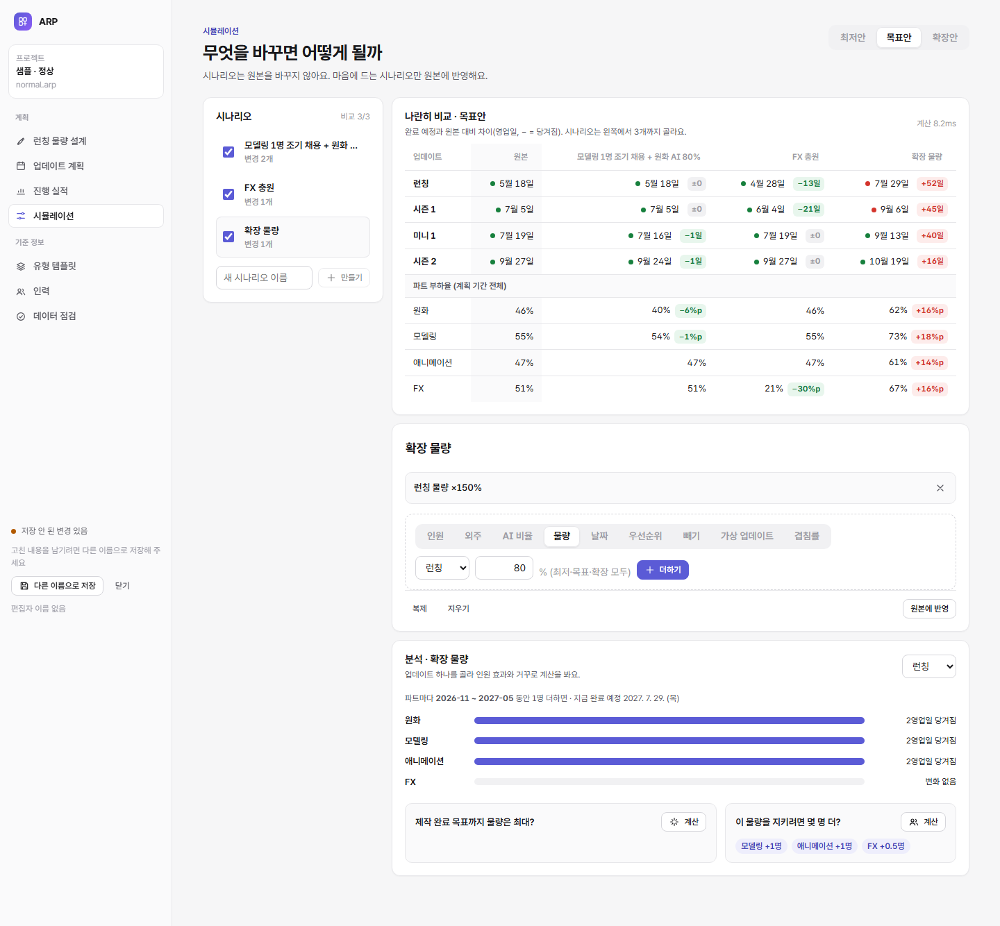

# 4단계: 시뮬레이션

```bash
npm run dev     # → /app/index.html?sample=normal&page=simulation
npm run e2e     # … + 시뮬레이션 8
```



## 화면

| 영역 | 하는 일 |
|---|---|
| ① 시나리오 | 편집할 시나리오 하나를 고른다(누르기 = 편집). 새 시나리오 만들기. "변경 n개 · 원본 바뀜 · 반영됨" 표시 |
| ② 바꿀 것 · 이름 | 넣은 변경 목록(빼기), **결과 미리보기**(원본 대비 업데이트별 완료 예정 · 차이), **변경 추가**(17종을 인력 · 효율 · 물량 · 일정 네 무리 칩으로 한눈에, 입력 칸 옆에 "지금 값"), 복제 · 지우기 · 원본에 반영. 이름은 제목에서 바꾼다 |
| ③ 결과 비교 | 비교할 시나리오 체크(편집 중인 시나리오는 늘 포함, 최대 3개). 원본과 시나리오의 업데이트별 완료 예정, 원본 대비 차이(− 초록 = 당겨짐, + 빨강 = 늦어짐), 파트 부하율과 %p 차이 |
| ④ 업데이트 자세히 보기 | 편집 중인 시나리오(없으면 원본) 위에서 업데이트 하나를 골라 파트별 +1명 효과, 제작 완료 목표까지 최대 물량, 필요 인원 |

2026-11-06 개편: 한 칩에 "비교에 넣기(체크)"와 "편집(이름 누르기)"이 섞여 있던 것을 나눴다(①은 편집 대상만, 비교 대상은 ③에서). 편집 카드에 제목이 없고 "분석" 카드 이름이 모호하던 것을 번호 붙은 단계 제목으로 바꿨다. 바꿀 것 목록 상자에 가려 "인원"만 보이던 것을 무리별 칩으로 모두 보이게 했다.

### 동작 17가지

| 무리 | 동작 | 예 | 바뀌는 것 |
|---|---|---|---|
| 인력 | 인원 | 모델링 +2명, 2027-01~03 | 그 달들의 인원(더하기) |
| 인력 | 가동률 | FX 90%, 기간 | 그 달들의 가동률(값으로) |
| 인력 | 생산성 | 원화 ×1.2, 기간 | 그 달들의 생산성(값으로) |
| 인력 | 외주 | FX +20인·일/월, 기간 | 그 달들의 외주 인·일(더하기) |
| 인력 | 임시 지원 | 모델링 +10인·일/월, 기간 | 그 달들의 지원 인·일(더하기) |
| 효율 | AI 비율 | 원화 80% | 원화의 기본·AI 공수 섞는 비율 |
| 효율 | AI 공수 절감 | 원화 50% 절감 | 원화를 거치는 모든 리소스의 AI 공수 = 기본 공수 × (1 − 절감) |
| 효율 | 재작업률 | FX 20% | FX를 거치는 모든 리소스의 재작업률 |
| 효율 | 겹침률 | 모두 30% 또는 원화 → 모델링 50% | 기본 겹침률·파트 쌍 |
| 효율 | 여유율 | 15% | 모든 공수에 더해 두는 몫(전체 공통) |
| 물량 | 물량 배율 | 시즌 1 ×80% | 그 업데이트의 세 템플릿 수량 모두 |
| 물량 | 리소스 수량 | 런칭 신규 캐릭터 기본안 12개 | 리소스 하나, 템플릿 하나의 수량 |
| 물량 | 최소 물량으로 | 시즌 1(선택 리소스만) | 기본안·최대안 수량을 최소안 수량으로 |
| 일정 | 날짜 | 런칭 출시 2027-07-31 | 시작 · 제작 완료 목표 · 출시 |
| 일정 | 우선순위 | 미니 1을 0(맨 앞) | 우선순위 |
| 일정 | 빼기 | 미니 1 빼기 | 상태를 취소로(계산에서 빠짐) |
| 일정 | 가상 업데이트 | 이벤트, 3/1 ~ 5/15, 미니 유형 | 업데이트 + 템플릿 물량을 넣음 |

- 인원·외주는 **더하기 값**으로 저장한다(`{"add": 2}`). 계산할 때 그때의 원본 값에 더한다(0 밑으로는 안 내려감). 같은 칸에 동작을 여러 번 넣으면 더해지고, 중간 동작을 빼도 나머지가 맞다(2026-11-05 전체 점검에서 바꿈. 그 전에는 만든 시점의 절댓값이라 덮어썼다).
- 그 밖의 동작은 만든 시점의 원본 값으로 계산해 저장한다.
- 시나리오 줄 하나가 넣을 수 없으면(키 겹침·형식 위반) 그 줄만 건너뛰고 이유를 알린다. 넣기는 같은 키가 이미 있으면 덮어쓴다.
- 원본을 그 뒤에 고치면 "원본 바뀜"으로 알리고(규칙 X02), 반영할 때 한 번 더 확인을 받는다.

## 원본에 반영

1. 시나리오 변경을 원본에 쓴다. 한 트랜잭션이고, 줄마다 변경 이력을 남긴다(이유 = "시나리오 반영: 이름").
2. 검증을 돌린다. 오류가 생기면 전부 되돌리고 이유를 알린다. 예: 출시일이 시작일보다 앞.
3. 성공하면 시나리오에 반영 시각을 남긴다. 그 뒤로는 고치거나 다시 반영할 수 없다. 복제는 된다.
4. 시나리오를 만든 뒤 원본을 고쳤다면 "그래도 반영"을 눌러야 한다.

**완료 조건 확인:** 반영한 뒤의 원본 결과가 반영 전 시나리오 결과와 같다(검사·크롬 시험 모두).

## 파일 구조 v2 (처음 쓰는 구조 전환)

시나리오 변경을 "동작" 단위로 묶어야 해서 칸을 더했다. [core/migrate.ts](../core/migrate.ts)

| 표 | 더한 칸 |
|---|---|
| `scenario_changes` | `group_no`(동작 번호), `label`(동작 이름) |
| `scenarios` | `applied_at`(원본에 반영한 시각) |

- 옛 파일(v1)은 열 때 자동으로 바뀐다. Node 도구는 파일에 바로 쓰고, 브라우저는 메모리에서 바꾼 뒤 저장할 때 쓴다. 화면에 "옛 구조(v1) 파일을 새 구조(v2)로 바꿨어요"라고 알린다.
- 새 파일도 v1을 만든 뒤 같은 단계를 밟는다. 그래서 새 파일과 바꾼 파일의 구조가 항상 같다.
- 더 새 구조의 파일은 열지 않는다.
- 아직 안 한 것: 바꾸기 전 원본을 `.v1.bak.arp`로 따로 남기기(5단계).

## 로직

| 파일 | 내용 |
|---|---|
| [core/scenarios.ts](../core/scenarios.ts) | 동작 → 변경 줄 만들기, 시나리오 만들기·복제·이름·지우기·동작 빼기, 목록, 비교, 민감도, 원본에 반영, 화면용 목록 |
| [core/pipeline.ts](../core/pipeline.ts) | 시나리오 얹기: 기본 키 색인으로 찾는다(`keyWhere`), 표 구조는 한 번만 묻는다(`tableColumns`) |

**"원본 바뀜" 판단:** 데이터 버전이 아니라 변경 이력으로 본다. 데이터 버전은 시나리오만 고쳐 저장해도 오르기 때문이다. 시나리오를 만든 시각 뒤에 계획 데이터 변경 이력이 있으면 바뀐 것으로 본다.

## 속도

| 측정 | 현실 규모 · CPU 보통 | 현실 규모 · CPU 4배 느리게 | 과부하 규모 · CPU 보통 |
|---|---|---|---|
| 원본 + 시나리오 3개 비교 (Node) | 68ms | — | — |
| 원본 + 시나리오 3개 비교 (크롬) | **72ms** | 336ms | 270ms |

- **처음 구현:** 시나리오를 얹을 때 변경 한 줄마다 표 구조를 묻고, 키를 이어 붙인 문자열로 찾아 색인을 못 썼다. Node에서 166ms였다. 기본 키로 찾도록 바꿔 68ms가 됐다.
- **목표(0.3초):** 보통 CPU에서는 충족한다. 4배 느린 CPU에서는 0.34초로 조금 넘는다. 계산은 별도 스레드라 화면은 멈추지 않는다.
- **더 줄이려면:** 지금은 시나리오마다 검증 36개를 다 돈다. 규칙에 "쓰는 표"를 적어 두고, 시나리오가 건드린 표의 규칙만 다시 돌리면 된다(5단계 후보).

## 검사

| 종류 | 개수 | 내용 |
|---|---|---|
| 검사 [test/scenarios.test.mjs](../test/scenarios.test.mjs) | 14 | 구조 전환(v1→v2, 다시 해도 그대로, 더 새 버전 거절), 시나리오 고치기, 비교(당겨짐·늦어짐·빠짐·가상), 원본 불변, 민감도, 반영(값·이력·결과 일치·두 번 거절), 원본 바뀜 확인·오류 시 되돌림, 속도 |
| 크롬 시험 [tools/e2e-sim.mjs](../tools/e2e-sim.mjs) | 11 | 예시 비교, 동작 이름, 시나리오 만들기 → FX +2명 → 런칭 −13영업일, 물량 150% → +52영업일, 3개 비교, 17종 네 무리, 가동률 · AI 공수 절감 · 리소스 수량 더하기(지금 값 표시), 결과 미리보기, 분석, 반영 → 원본 = 시나리오 결과, 저장 대기 |

전체: 검사 56개, 크롬 시험 41개 통과.
