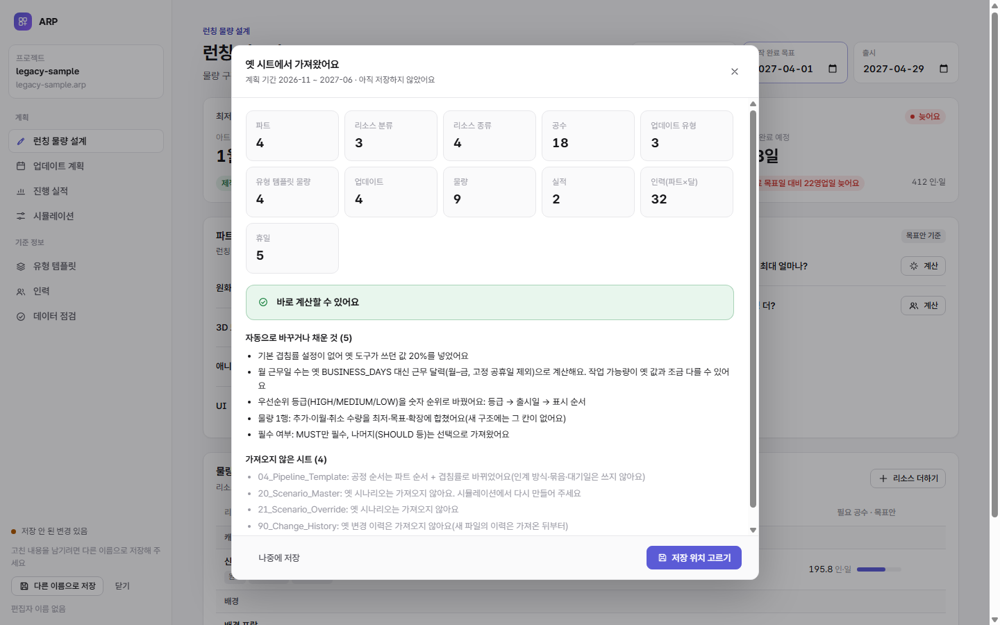

# 4.5단계: 옛 시트 가져오기

```bash
npm run compare-legacy        # 옛 엔진 ↔ 새 엔진 대조 (옛 도구 폴더 ../arp 필요)
npm run dev                   # → /app/index.html?importSample=legacy-sample  (예시 옛 시트를 바로 가져오기)
```

> 실제 운영 시트를 준비하는 법과 운영 규모 시험 결과는 [15-operating-sheet.md](15-operating-sheet.md)에 있다.

## 쓰는 법

1. 구글 시트(옛 도구)에서 **파일 → 다운로드 → Microsoft Excel(.xlsx)**을 고른다.
2. 앱 시작 화면에서 **기존 시트(.xlsx) 가져오기**를 누르고 그 파일을 고른다.
3. 보고서를 확인한다. 무엇을 얼마나 가져왔고, 무엇을 바꾸거나 건너뛰었고, 어떤 시트를 가져오지 않았는지 나온다.
4. **저장 위치 고르기**로 `.arp` 파일로 저장한다.



## 엑셀 읽기 ([core/xlsx.ts](../core/xlsx.ts))

- 라이브러리 없이 읽는다. 유지비가 들지 않고 의존 패키지도 늘지 않는다.
- ZIP 목차를 읽고, 필요한 XML만 브라우저 기본 기능(`DecompressionStream`)으로 푼다.
- 공유 문자열, 글자 칸, 숫자, 참/거짓 값을 읽는다. 서식·수식·병합은 보지 않고 값만 쓴다.
- 날짜는 엑셀 일련번호도 읽고 `2026-11-02`, `2026.11.02` 같은 글자도 읽는다.
- 계산 스레드(Worker)에는 XML 해석기가 없어서 필요한 태그만 직접 읽는다.

## 옛 → 새 ([core/import-legacy.ts](../core/import-legacy.ts))

| 옛 시트 | 새 표 | 바꾸는 것 |
|---|---|---|
| 00_Config | 설정, 겹침률 | 여유율, 부하율 기준, 기본 물량 구간, 파트 쌍 겹침률. **기본 겹침률이 없으면 옛 엔진이 쓰던 20%를 적는다** |
| 01_Part_Master | 파트 | 작업 가능량 대상이 아닌 파트는 "사용 안 함" |
| 02_Resource_Master | 분류, 리소스 종류 | GROUP → 분류, 나머지 → 리소스 종류(가장 가까운 GROUP 조상이 분류) |
| 03_Effort_Standard | 거치는 파트, 공수(기본·AI) | 기본·AI 공수가 모두 비면 거치지 않는 파트로 본다 |
| 05_Update_Type · 06_Update_Volume_Template | 유형, 템플릿 | ID가 LAUNCH거나 이름에 "런칭"이 있으면 런칭 유형 |
| 10_Update_Master | 업데이트 | 등급(HIGH/MEDIUM/LOW) → 숫자 순위(등급 → 출시일 → 표시 순서). 출시일이 비면 목표 월 말일. 사용 안 함 → 취소 |
| 11_Update_Volume | 물량 | 추가·이월·취소 수량을 최저·목표·확장에 합침. 최저가 비었거나 0이면 목표. MUST만 필수 |
| 12_Capacity_Monthly | 인력, 계획 기간 | 계획 기간 = 인력이 있는 첫 달 ~ 마지막 달(최대 60개월). BUSINESS_DAYS 대신 근무 달력 |
| 13_Progress_Actual | 실적 | 완료 + 외주 완료 + 규격 제외 = 완료 수량 |
| 04 · 20 · 21 · 90 · 그 밖의 시트 | — | 가져오지 않는다(보고서에 이유) |

**원칙:**
- 값 규칙 위반(예: 기본 공수 빈칸, 인력 없는 달)은 그대로 들여온다. 데이터 점검에서 보이게 하고, 보고서에 고칠 곳 개수를 알린다.
- 형식 오류(없는 ID를 가리키는 행 등)는 건너뛰고, 행마다 이유를 남긴다.

## 옛 엔진과 대조 ([tools/compare-legacy.mjs](../tools/compare-legacy.mjs))

같은 옛 샘플 데이터를 옛 도구 엔진(Apps Script 코드를 Node 하네스로)과, 엑셀 → 가져오기 → 새 엔진으로 각각 계산했다.

| 비교 | 옛 근무일 수에 맞춤(대조용 설정) | 기본(근무 달력 + 고정 공휴일) |
|---|---|---|
| 파트별 필요 공수 | **같음** (4파트 모두) | 같음 |
| 파트별 작업 가능량 | **같음** | 5.6% 많음(한 달 근무일이 옛 고정값 20일보다 많다) |
| 업데이트 완료 예정 | **4개 모두 0일 차이** | 2~9일 빠름 |

- **찾은 것:** 옛 엔진은 기본 겹침률 설정이 없으면 코드에 박힌 20%를 썼다. 처음 가져오기는 이것을 몰라 완료 예정이 7~12일 늦게 나왔다. 가져올 때 20%를 설정에 적도록 고쳐 같아졌다.
- 실제 운영 시트는 내려받은 .xlsx를 그대로 넣어 대조한다: `npm run compare-legacy -- private/운영시트.xlsx`.
- 대조 모드("옛 계산 방식 흉내", `legacyCompat`)는 옛 근무일 수를 쓰고, 상태를 무시하고, 인력이 없는 달은 마지막 달로 되풀이한다. 운영 규모 시트에서도 모두 0 차이다([15-operating-sheet.md](15-operating-sheet.md)).
- 사용 여부(`ACTIVE`)는 옛 도구와 같은 규칙이다. 체크·`TRUE`·`Y`·`YES`·`1`만 사용이고 빈칸은 사용 안 함이다(2026-11-05 운영 시트 시험에서 찾아 고침).

## 검사

| 종류 | 개수 | 내용 |
|---|---|---|
| 검사 [test/import.test.mjs](../test/import.test.mjs) | 5 | 엑셀 읽기(두 압축 방식, 특수 문자, 날짜 일련번호, 엑셀이 아닌 파일), 옛 샘플 가져오기(개수·순위·합치기·필수·런칭·여유율), 날짜·빈 출시일·모르는 상태·없는 리소스, 옛 시트가 아님, 옛 엔진과 대조 |
| 크롬 시험 [tools/e2e-import.mjs](../tools/e2e-import.mjs) | 7 | 가져오기 버튼, 보고서 내용, 바로 계산, 런칭 화면, 저장 전 상태, 업데이트 순서 |

전체: 검사 61개, 크롬 시험 48개 통과.

## 남은 일

- **실제 운영 시트로 가져오기와 대조:** 사람이 해야 한다. 실제 시트에는 옛 도구가 덧붙인 보조 칸이나 다른 시트 이름이 있을 수 있어, 보고서를 보고 매핑을 보완한다.
