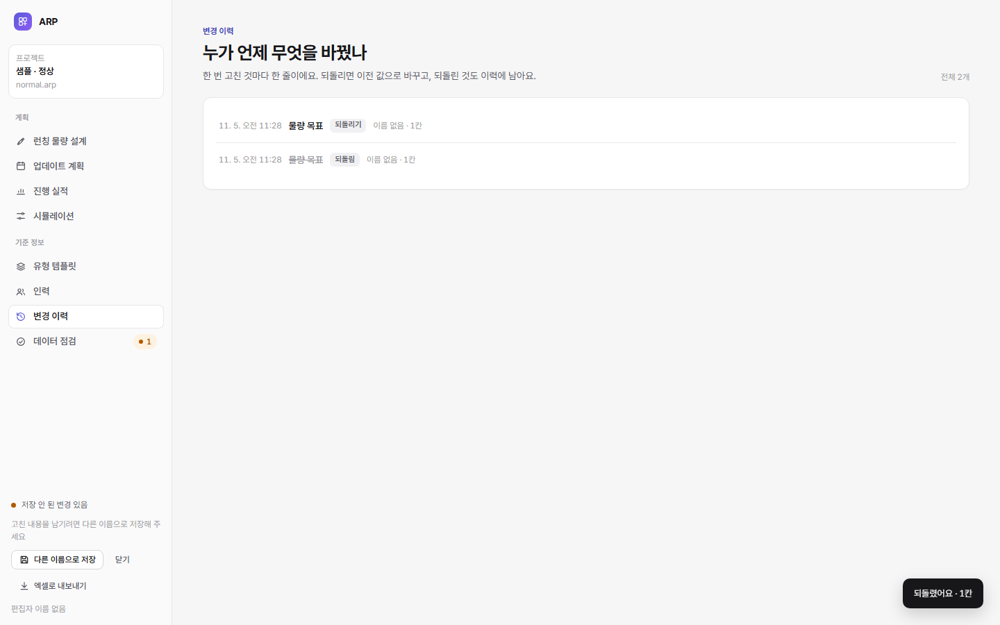
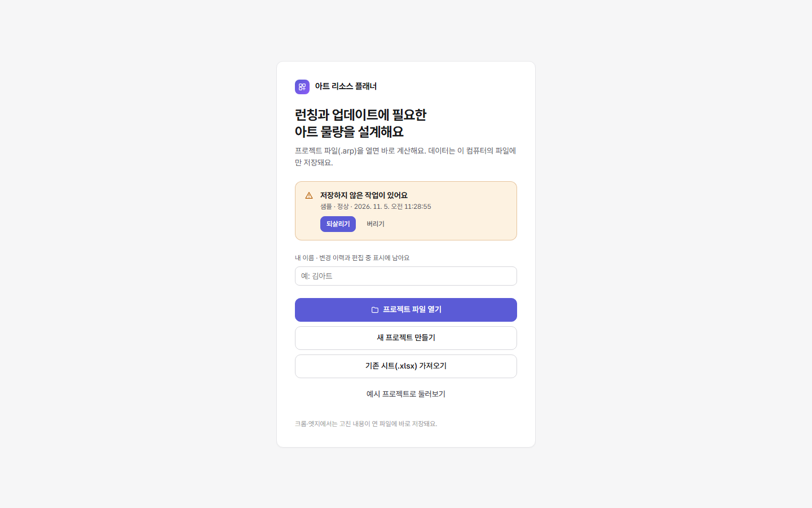

# 5단계: 안정화

서버가 없는 앱에서 **데이터를 잃지 않고, 실수를 되돌리고, 오프라인에서도 쓰고, 운영할 수 있게** 하는 단계다.

```bash
npm run e2e      # … + 안정화 9
```

## 들어간 것

| 기능 | 내용 | 코드 |
|---|---|---|
| 변경 이력 + 되돌리기 | 한 번 고친 것마다 한 줄. 펼치면 칸별 이전 → 이후. 되돌리기는 이전 값을 다시 쓰고 그 자체도 이력에 남는다 | [core/history.ts](../core/history.ts), [HistoryPage](../web/app/ui/HistoryPage.tsx) |
| 작업 복구 | 저장 안 된 변경이 생기면 1.5초 뒤 브라우저 저장소에 사본. 저장하면 지운다. 창을 닫았다 열면 "되살리기" | [web/app/lib/idb.ts](../web/app/lib/idb.ts) |
| 최근 파일 | 핸들로 연·저장한 파일 6개를 시작 화면에. 누르면 권한을 한 번 묻고 연다 | idb.ts |
| 구조 전환 전 원본 | 옛 구조 파일을 열면 바꾸기 전 원본을 `이름.v1.bak.arp`로 받을 수 있게 알린다 | App.tsx |
| 엑셀로 내보내기 | 시트 9개: 요약 · 업데이트 전망 · 파트 부하 · 물량 · 인력 · 공수 · 실적 · 데이터 점검 · 변경 이력. 첫 행 굵게 고정, 열 너비 자동 | [core/export.ts](../core/export.ts), [core/xlsx-write.ts](../core/xlsx-write.ts) |
| 오프라인 · 설치형 앱(PWA) | 배포 빌드에서 서비스 워커가 앱 파일을 담아 둔다. 한 번 열면 인터넷 없이도 뜬다. 크롬 주소창의 "설치"로 앱처럼 쓸 수 있다 | [vite.config.mjs](../vite.config.mjs) |
| 오류 처리 | 화면 오류는 "문제가 생겼어요" 화면(작업 사본은 남아 있음), 비동기 오류는 알림 | [web/app/main.tsx](../web/app/main.tsx) |



## 되돌리기 규칙

- **묶음 = 한 번 고친 것.** 물량 한 칸, 업데이트 만들기(물량 복사 포함), 시나리오 반영 하나 같은 단위다. 4단계까지는 저장 한 번이 한 묶음이라 너무 컸다. 이제 고칠 때마다 새 묶음이다.
- **되돌리는 방법:** 고친 값은 이전 값으로, 추가한 행은 지우고, 지운 행은 다시 넣는다. 업데이트를 지울 때 함께 지운 물량, 유형을 지울 때 함께 지운 템플릿도 다시 넣는다. 계획 기간도 되돌린다.
- **뒤에 같은 칸을 또 고쳤다면** 그 값도 덮어쓰므로 "그래도 되돌리기"를 한 번 더 누르게 한다.
- **되돌린 결과가 계산할 수 없는 상태**(검증 오류)면 전부 취소한다.
- 같은 묶음은 한 번만 되돌린다.

## 작업 복구와 최근 파일



- **사본이 남는 경우:** 저장 위치가 없는 파일(예시, 가져온 시트, 새로 만든 뒤 저장 안 함)이나 자동 저장 전 2초 사이에 창이 닫혀도 사본이 남는다.
- **원칙:** 브라우저 저장소는 사본과 편의 기능에만 쓴다. 지워져도 원본 파일은 그대로다.

## 오프라인 (PWA)

- 빌드할 때 Vite 설정의 작은 플러그인이 만들어진 파일 목록으로 서비스 워커(`app/sw.js`), `manifest.webmanifest`, 아이콘을 만든다. 추가 패키지는 없다.
- **캐시 이름:** 파일 목록의 해시라서 새로 배포하면 새 캐시로 바뀌고 옛 캐시는 지운다.
- **동작:** 앱 파일은 캐시에서 먼저 꺼내고, 없으면 네트워크로 받는다. 페이지 이동은 주소 뒤 조건(`?…`)을 무시하고 index.html로 응답한다.
- 개발 서버(`npm run dev`)와 `?nosw` 주소에서는 등록하지 않는다(캐시가 개발을 방해하지 않게).

## 검사

| 종류 | 개수 | 내용 |
|---|---|---|
| 검사 [test/history.test.mjs](../test/history.test.mjs) | 5 | 이력 요약, 되돌리기 4종(값 · 업데이트 만들기 · 지우기(물량까지) · 계획 기간) 후 결과가 처음과 같음, 두 번 거절 · 같은 칸 확인, 오류 시 취소, 엑셀 내보내기(시트 9개 · 결과 일치 · 다시 읽힘) |
| 크롬 시험 [tools/e2e-stable.mjs](../tools/e2e-stable.mjs) | 9 | 이력 · 되돌리기, 엑셀 파일(PK 서명), 되살리기 제안 · 값 복원, 최근 파일 목록 · 다시 열기, 옛 구조 원본 알림, 인터넷 끊김에도 앱이 뜸 |

전체: 검사 66개, 크롬 시험 57개 통과.

## 남은 일 (필요할 때)

| 항목 | 이유 |
|---|---|
| 검증 줄이기(규칙에 "쓰는 표" 표시) | 시나리오 3개 비교가 느린 CPU에서 0.34초로 목표를 조금 넘음 |
| 탭을 그냥 닫을 때 편집 중 표시 지우기 | 지금은 30분 뒤 자동으로 풀린다. 브라우저가 닫히는 순간에는 파일 쓰기를 보장하지 않는다 |
| 실제 공유 드라이브에서 두 사람이 번갈아 쓰기 확인 | 사람이 할 일 |
