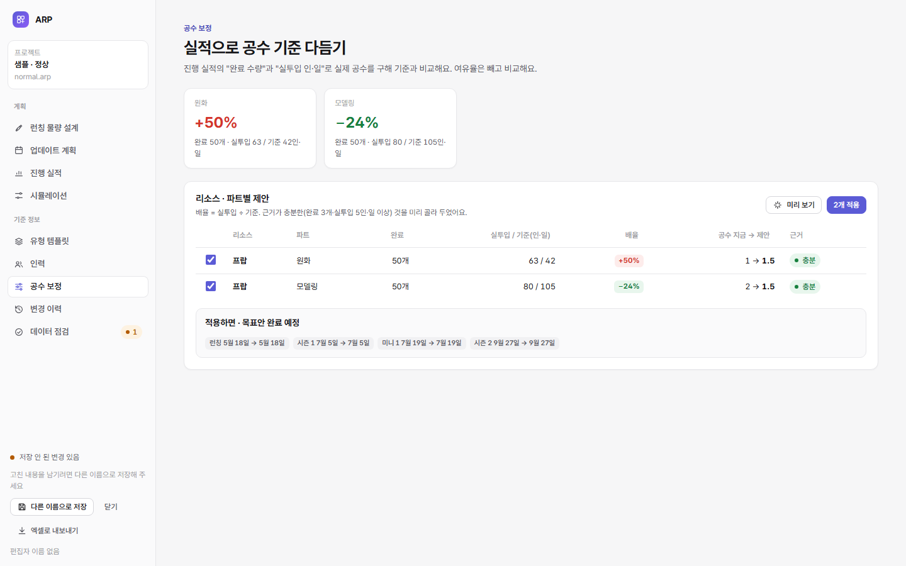
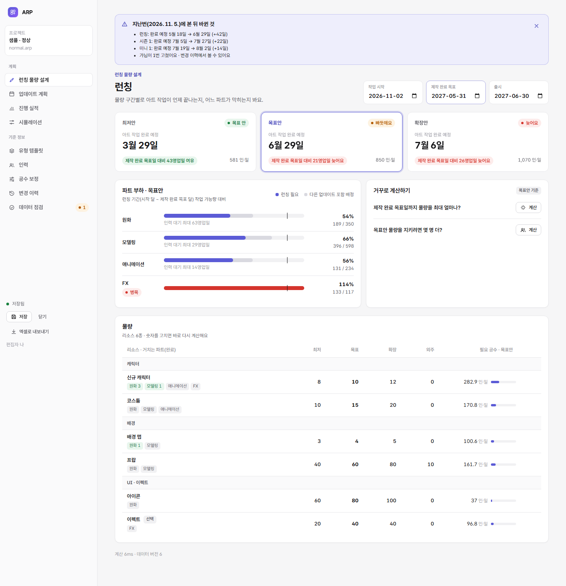

# 6단계: 확장

```bash
npm run e2e     # … + 6단계 10
```

## 들어간 것

| 기능 | 내용 | 코드 |
|---|---|---|
| 실투입 공수 | 진행 실적에 "실투입 인·일" 칸(완료 수량 ↔ 실투입 전환). 파일 구조 **v3** | [core/edits.ts](../core/edits.ts) `progressSpent`, [core/migrate.ts](../core/migrate.ts) |
| 공수 보정 제안 | 실투입 ÷ 기준으로 리소스·파트별 배율 제안, 근거(충분·적음), 적용 전 미리 보기, 적용은 한 묶음(되돌리기 가능) | [core/calibration.ts](../core/calibration.ts), [CalibrationPage](../web/app/ui/CalibrationPage.tsx) |
| 실적 엑셀 | **양식 받기**(지금 값이 채워진 표) → 채워서 **엑셀로 넣기**. 다른 도구 표도 머리글·이름으로 맞춘다. 넣기는 한 묶음 | [core/progress-io.ts](../core/progress-io.ts) |
| 열 때 변화 알림 | 내가 지난번에 본 뒤 완료 예정이 바뀐 업데이트, 새로 생기거나 빠진 업데이트, 다른 사람이 고친 횟수 | [core/notice.ts](../core/notice.ts) |
| 시나리오 비교 빠르게 | 규칙마다 읽는 표를 적어 시나리오가 건드린 표의 규칙만 다시 검증. 원본이 그대로면 원본 계산 결과를 다시 씀 | [rules/validation-rules.mjs](../rules/validation-rules.mjs) `RULE_TABLES` |



## 공수 보정 계산

```
기준 인·일 = 완료 수량 × 공수(프로필 섞은 값) × 난이도 × (1 − 재사용률) × (1 + 재작업률)   ← 여유율은 계획 여유라 뺀다
배율       = 실투입 인·일 ÷ 기준 인·일
제안 공수   = 지금 공수 × 배율(그 리소스·파트의 모든 공수 판에 같은 배율)
근거 충분   = 완료 3개 이상 그리고 실투입 5인·일 이상
```

- **예(검사로 고정):** 프랍 원화의 기준은 1 × (기본 0.5 + AI 0.6 반반 = 0.8) × 1.05 = 0.84인·일/개다. 50개면 42인·일이다. 실투입이 63인·일이면 배율은 1.5배이고, 기본 공수 1 → 1.5, AI 0.6 → 0.9를 제안한다.
- **미리 보기:** 고른 보정을 메모리에서만 적용해, 업데이트별 완료 예정이 어떻게 바뀌는지 보여준다.

## 실적 엑셀

- **양식:** 계산 대상 업데이트 × 물량 × 거치는 파트마다 한 줄이다. 칸은 ID·이름, 목표, 완료 수량, 실투입 인·일, 기준일이다. 안내 시트가 함께 있다.
- **넣기:** 머리글은 이름을 보고 찾는다(한국어·영어, 공백 무시). 행은 ID가 있으면 ID로, 없으면 이름으로 맞추고, 이름이 겹치면 ID를 요구한다.
- **빈칸·0:** 빈칸은 바꾸지 않는다. 0은 그 값을 지운다.
- **보고:** "n칸 바뀜, n칸 그대로, 건너뛴 행(행 번호 · 이유)"을 알린다.

## 열 때 변화 알림



- 서버가 없으므로 **"지난번에 본 전망"은 각자 브라우저에 편집자별로** 둔다. 파일을 열 때와 저장할 때 갱신한다.
- 다른 사람이 고친 횟수와 이름은 파일의 변경 이력에서 센다.
- 계산이 막힌 상태(검증 오류)면 비교하지 않는다. 그렇지 않으면 모든 업데이트가 "빠졌다"고 잘못 알리게 된다(검사로 고정).

## 파일 구조 v3

| 표 | 더한 칸 |
|---|---|
| `progress` | `spent_days` (실투입 인·일) |

옛 파일(v1·v2)은 열 때 자동으로 바뀐다. v1 → v2 → v3 차례로 바뀌고, 바꾸기 전 원본을 받을 수 있다.

## 속도 (시나리오 3개 비교, 현실 규모, 크롬)

| | 5단계 | 6단계 |
|---|---|---|
| CPU 보통 | 72ms | **64ms** |
| CPU 4배 느리게 | 336ms | **약 320ms** |

- 목표 0.3초를 보통 CPU에서는 충족한다. 느린 CPU에서는 아직 조금 넘는다.
- 남은 시간 대부분은 시나리오마다 엔진을 새로 돌리는 몫이다. 더 줄이려면 계산을 여러 스레드로 나눠야 한다. 비교는 별도 스레드에서 돌아 화면은 멈추지 않는다.
- 검증 줄이기는 "일부 검증 결과 = 전체 검증 결과" 검사로 정확성을 확인한다.

## 검사

| 종류 | 개수 | 내용 |
|---|---|---|
| 검사 [test/calibration.test.mjs](../test/calibration.test.mjs) | 5 | 실투입(넣기·완료 없이·지우기·되돌리기), 보정 배율(손 계산)·근거·파트 합계, 미리 보기·적용·이력·되돌리기, 실적 엑셀(양식 → 넣기 · 이름으로 · 보고), 변화 알림(변화·새 업데이트·다른 사람·막힌 상태) |
| 검사 [test/scenarios.test.mjs](../test/scenarios.test.mjs) 추가 | 1 | 모든 규칙에 읽는 표 · 일부 검증 = 전체 검증 |
| 크롬 시험 [tools/e2e-ext.mjs](../tools/e2e-ext.mjs) | 10 | 실투입 → 보정 제안(+50%·−24%) → 미리 보기 → 적용 → 이력, 양식 받기, 엑셀 넣기(2칸·건너뜀 1), "나"가 본 뒤 "가"가 고치면 다시 열 때 알림 |

전체: 검사 72개, 크롬 시험 67개 통과.
