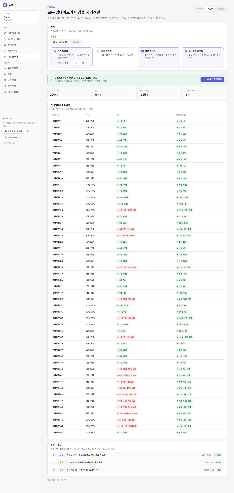
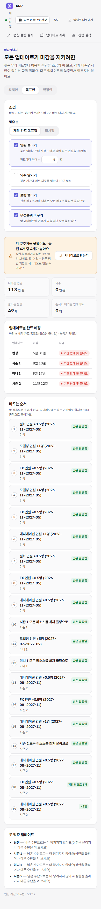

# 7단계: 마감 맞추기

```bash
npm test        # … + 마감 맞추기 8
npm run e2e     # … + 마감 맞추기 14
```

모든 계산 대상 업데이트가 마감을 지키려면 **무엇을 얼마나 바꿔야 하는지** 제안한다. 원본은 바꾸지 않는다. **시나리오로 만들기**를 누르면 시뮬레이션에서 원본과 비교하고, 마음에 들면 원본에 반영한다(4단계 흐름 그대로).



## 조건

| 항목 | 기본 | 내용 |
|---|---|---|
| 맞출 날 | 제작 완료 목표일 | 제작 완료 목표일(없으면 출시일) 또는 출시일 |
| 물량 구간 | 화면 위 최저·목표·확장 | 그 구간 물량으로 계산 |
| 인원 늘리기 | 켬 · 파트마다 최대 +5명 | 늦는 업데이트의 시작 달 ~ 마감 달에 그 파트 인원을 0.5명씩 |
| 외주 맡기기 | 끔 · 파트·달마다 최대 +40인·일 | 같은 기간에 파트 외주를 달마다 10인·일씩 |
| 물량 줄이기 | 켬 | 선택 리소스를 최저 물량으로 → 그래도 늦으면 모든 리소스를 최저 물량으로 |
| 우선순위 바꾸기 | 켬 | 늦는 업데이트를 바로 앞 업데이트와 순서 바꾸기 |

## 고르는 방법

```
되풀이:
  늦는 업데이트 중 우선순위가 가장 높은 것을 고른다(더 못 당기는 것은 건너뜀)
  후보 걸음을 만든다
    - 인원·외주: 원인 파트 + 그 업데이트에서 마감을 넘겨 끝나는(못 끝낸) 공정의 파트마다
    - 물량: 선택 → 모든 리소스 최저
    - 우선순위: 바로 앞 업데이트와 순서 바꾸기
  후보마다 엔진을 돌려 본다
    - 늦음 점수가 줄지 않으면 버린다
    - 어느 업데이트든 지금보다 늦어지면 버린다   ← 다른 업데이트를 희생해 맞추지 않는다
  남은 후보 중 "줄어든 늦음 ÷ (비용 + 0.5)"가 가장 큰 걸음을 받아들인다
  받아들일 후보가 없으면 인원·외주 걸음을 ×2, ×4로 키워 다시 해 본다(늦음이 계단처럼 줄 때)
  그래도 없으면 그 업데이트는 "못 맞춤"으로 두고 다음으로
멈춤: 모두 맞음 · 더 당길 업데이트 없음 · 엔진 400번 · 4초
```

| 항목 | 정의 |
|---|---|
| 늦음 | 마감 다음 영업일부터 완료 예정일까지 영업일. 기간 안에 못 끝나면 1000 + 남은 인·일 ÷ 10 |
| 인원 비용 | 더한 인원 × 달 수(인·월) |
| 외주 비용 | 외주 인·일 ÷ 20 × 달 수(인·월로 환산) |
| 물량 비용 | 줄어든 필요 공수 ÷ 20 × 1.5(같은 효과면 인원보다 비싸게 본다) |
| 우선순위 비용 | 0.3(거의 공짜. 다만 앞 업데이트에 여유가 있을 때만 통과) |

- **예(검사로 고정):** 정상 샘플에서 런칭 제작 완료 목표를 2027-03-31로 당기면 런칭이 32영업일 늦는다. 기본 조건이면 인원만 쓴다(모델링 +1, 애니메이션·FX +0.5명, 2026-11~2027-03, 10인·월). 런칭은 3/25에 끝나고 다른 업데이트는 그대로 맞는다.
- 물량만 허용하면 선택 리소스 → 모든 리소스 순서로 최저까지 줄여 3/29에 끝난다.
- 같은 파트·같은 기간에 연달아 더한 인원은 한 걸음("원화 인원 +2명")으로 묶어 보여 준다.

## 시나리오로 만들기

- 받아들인 걸음을 시나리오 동작으로 바꾼다.
  - 인원·외주: 파트별로 달마다 합친 뒤, 같은 값이 이어지는 달을 한 구간으로 묶는다.
  - 물량: 새 동작 **최저 물량으로**. 목표·확장 물량을 최저 물량으로 맞추고, 선택 리소스만 맞출 수도 있다.
  - 우선순위: 순서가 바뀐 경우에만 계산 대상 업데이트에 1, 2, 3 … 순위를 매긴다.
- 만들기는 한 번에 처리한다. 동작 하나라도 틀리면 시나리오를 남기지 않는다.
- 만든 뒤 시뮬레이션 화면으로 넘어간다. 새 시나리오가 골라져 있고, 원본과 나란히 비교된다.
- **검사로 고정:** 제안 결과의 완료 예정 = 그 시나리오의 비교 결과(업데이트마다). 세 가지 수단 조합과 현실 규모(우선순위 바꾸기 포함)에서 확인한다.

## 결과 화면

- **한 줄 판정:** 이미 맞음 / n걸음이면 모두 맞음 / 다 맞추지는 못함(남은 개수)
- **비용 4칸:** 더하는 인원(인·월), 외주(인·일), 줄이는 물량(개), 순서가 바뀌는 업데이트
- **업데이트별 완료 예정:** 지금 → 제안대로 하면
- **바꾸는 순서:** 걸음마다 수단, 내용, 도운 업데이트, 효과(−n일 / 기간 안으로 n개 / 남은 일 줄임)
- **못 맞춘 업데이트:** 이유(수단을 다 썼음 / 남은 수단으로는 더 안 당겨짐 / 계산 상한)
- 휴대폰 폭에서는 걸음을 두 줄로 줄인다.



## 속도 (Node, 이 PC)

| 데이터 | 결과 | 엔진 계산 | 시간 |
|---|---|---|---|
| 정상 샘플(마감 당김) | 맞춤, 3걸음 | 19번 | 5ms |
| 현실 규모(업데이트 50) | 늦던 17개 모두 맞춤, 3걸음 | 45번 | 약 0.3초 |
| 과부하 샘플 | 못 맞춤, 19걸음 | 256번 | 약 80ms |

계산은 별도 스레드에서 돌아 화면은 멈추지 않는다. 계산 중에는 결과가 흐려진다.

## 한계

- **한 걸음씩 고르는 방법**이라 가장 싼 조합이라는 보장은 없다. 대신 걸음마다 이유가 분명하고, 다른 업데이트를 희생하지 않는다.
- 인원·외주는 늦는 업데이트의 시작 ~ 마감 달에만 더한다. 그 밖의 달은 시뮬레이션에서 직접 바꾼다.
- 날짜 미루기와 업데이트 빼기는 제안하지 않는다. 사람이 정할 일이라 시뮬레이션의 **날짜 바꾸기 · 빼기** 동작으로 직접 해 본다.
- 과부하 샘플처럼 크게 넘치면 기본 상한으로는 못 맞춘다. 상한을 올리면 더 당기지만 공정 순서와 시작일 때문에 끝까지 못 맞출 수도 있다. 이때는 남은 업데이트와 이유를 보여 준다.

## 검사

| 종류 | 개수 | 내용 |
|---|---|---|
| 검사 [test/advisor.test.mjs](../test/advisor.test.mjs) | 8 | 이미 맞음, 마감 당김 → 인원만(아무도 안 늦어짐), 물량만(선택 → 모든 리소스), 수단 없음, 외주·인원 상한, 과부하(희생 없음·이유), 제안 = 시나리오 결과(3가지 조합 + 현실 규모 우선순위), 틀린 동작이면 남기지 않음, 최저 물량 동작 |
| 크롬 시험 [tools/e2e-advisor.mjs](../tools/e2e-advisor.mjs) | 14 | 이미 맞음, 과부하(걸음·이유), 수단 끄기·외주 켜기, 현실 규모 맞춤 → 시나리오로 만들기 → 시뮬레이션에서 원본과 비교(늦음 0), 휴대폰 폭 |

전체: 검사 80개, 크롬 시험 81개.
