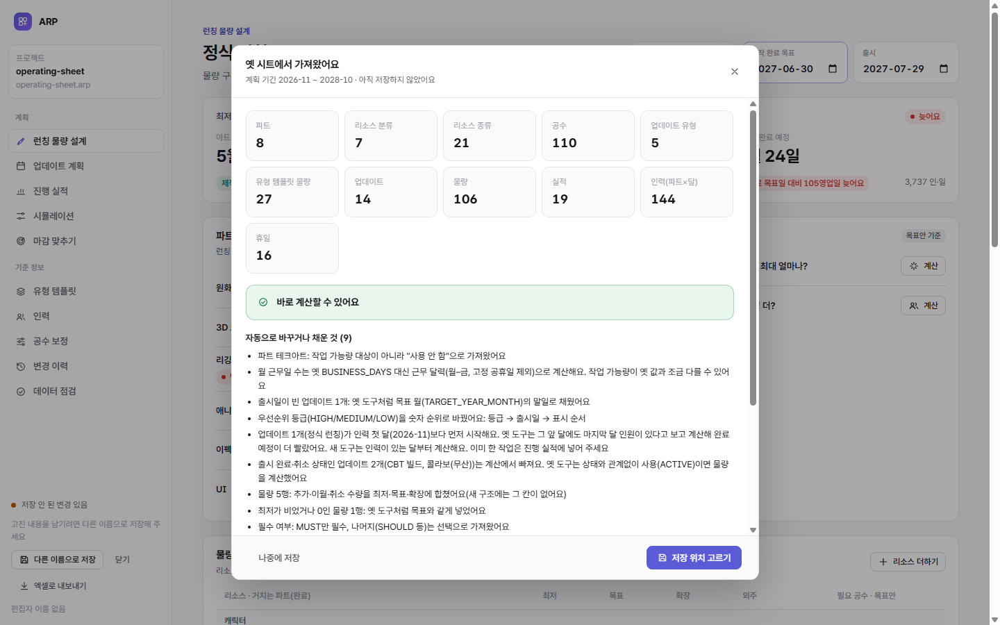

# 운영 시트 준비 가이드

옛 도구(구글 시트 + Apps Script)의 데이터를 새 앱으로 옮길 때 무엇을 얼마나 준비하면 되는지 정리한다.

**결론:** 옛 도구에서 **계산이 되던 시트라면 고칠 것 없이 그대로 내려받으면 된다.** 아래 점검표는 결과가 옛 도구와 왜, 얼마나 다를지 미리 알기 위한 것이다.

## 1. 내려받기

1. 구글 시트(옛 도구의 데이터 시트)를 연다.
2. **파일 → 다운로드 → Microsoft Excel(.xlsx)**
3. 파일을 `arp-next\private\` 에 둔다. 이 폴더는 git에 올라가지 않는다.

시트 이름(`01_Part_Master` …)과 머리글(1행)은 바꾸지 않는다. 열 순서와 보조 칸은 상관없다(머리글 이름으로 찾는다).

## 2. 어떤 시트를 읽나

| 시트 | 꼭 있어야 | 읽는 칸 | 새 앱에서 |
|---|---|---|---|
| `00_Config` | — | `CONFIG_KEY` · `CONFIG_VALUE` (여유율, 부하 기준, 기본 물량 구간, `STAGE_OVERLAP_RATE_DEFAULT`, `STAGE_OVERLAP_RATE:앞>뒤`, `EFFORT_PROFILE`) | 설정 · 겹침률 |
| `01_Part_Master` | ✔ | `PART_ID` · `PART_NAME` · `SORT_ORDER` · `ACTIVE` · `IS_CAPACITY_TARGET` | 파트(순서 = 공정 순서) |
| `02_Resource_Master` | ✔ | `RESOURCE_ID` · `RESOURCE_NAME` · `RESOURCE_LEVEL`(GROUP이면 분류) · `PARENT_RESOURCE_ID` · `SORT_ORDER` · `ACTIVE` | 분류 · 리소스 종류 |
| `03_Effort_Standard` | ✔ | `RESOURCE_ID` · `PART_ID` · `BASE_DAYS` · `AI_ASSISTED_DAYS` · `DEFAULT_REWORK_RATE` | 거치는 파트 · 공수 |
| `05_Update_Type` | — | `UPDATE_TYPE_ID` · `UPDATE_TYPE_NAME` · `SORT_ORDER` · `ACTIVE` | 업데이트 유형(ID가 `LAUNCH`면 런칭) |
| `06_Update_Volume_Template` | — | `UPDATE_TYPE_ID` · `RESOURCE_ID` · `MIN_QTY` · `TARGET_QTY` · `STRETCH_QTY` · `ACTIVE` | 유형 템플릿 |
| `10_Update_Master` | ✔ | `UPDATE_ID` · `UPDATE_NAME` · `UPDATE_TYPE_ID` · `PLAN_START_DATE` · `CONTENT_FREEZE_DATE` · `RELEASE_DATE` · `TARGET_YEAR_MONTH` · `PRIORITY` · `STATUS` · `SORT_ORDER` · `ACTIVE` · `DESCRIPTION` | 업데이트 |
| `11_Update_Volume` | ✔ | `UPDATE_ID` · `RESOURCE_ID` · `MIN_QTY` · `TARGET_QTY` · `STRETCH_QTY` · `ADDED_QTY` · `CARRYOVER_IN_QTY` · `CANCELLED_QTY` · `OUTSOURCE_QTY` · `REUSE_RATE` · `DIFFICULTY_FACTOR` · `REQUIRED_LEVEL` · `PRIORITY` · `CHANGE_REASON` | 물량(추가·이월·취소는 합침) |
| `12_Capacity_Monthly` | ✔ | `YEAR_MONTH` · `PART_ID` · `HEADCOUNT` · `UTILIZATION_RATE` · `PRODUCTIVITY_FACTOR` · `OUTSOURCE_CAPACITY_DAYS` · `TEMP_SUPPORT_DAYS` · `NOTE` (`BUSINESS_DAYS`는 대조 때만) | 인력 · 계획 기간 |
| `13_Progress_Actual` | — | `UPDATE_ID` · `RESOURCE_ID` · `PART_ID` · `COMPLETED_QTY` · `OUTSOURCE_COMPLETED_QTY` · `SPEC_OUT_QTY` · `UPDATED_AT` | 진행 실적 |
| 그 밖의 시트 | — | 읽지 않는다(보고서에 이유) | `04` 공정, `20`·`21` 옛 시나리오, `90` 변경 이력, `33`·`34`·`98` 보조, 안내 시트 |

- 날짜 칸은 날짜 서식(엑셀 날짜), `2027-03-15`, `2027.03.15` 모두 읽는다.
- `ACTIVE`·`IS_CAPACITY_TARGET`은 **옛 도구와 같은 규칙**이다. 체크, `TRUE`, `Y`, `YES`, `1`만 "사용"이다. **빈칸이나 그 밖의 글자는 "사용 안 함"이다.**

## 3. 내려받기 전 점검표

옛 도구에서 계산이 되던 시트라면 아래 2개는 이미 지켜져 있다. 옛 도구가 계산을 거부하기 때문이다.

- [ ] 사용 안 함(`ACTIVE` 끔) 업데이트에 물량 행이 남아 있지 않다
- [ ] `03_Effort_Standard`에 `BASE_DAYS`가 빈 행이 없다(거치지 않는 파트는 행을 두지 않는다)

아래 3개는 **새 앱의 결과가 옛 도구와 달라지는 곳**이다. 고치지 않아도 가져오기는 되며, 보고서가 몇 건인지 알려 준다.

| 점검 | 옛 도구 | 새 앱 | 하면 좋은 것 |
|---|---|---|---|
| 상태가 출시 완료(`RELEASED`·`DONE`)·취소(`CANCELLED`)인데 사용 중이고 물량이 있는 업데이트 | 상태와 관계없이 계산(인력을 차지) | 계산에서 뺀다 | 할 것 없음(새 앱이 맞다). 옛 도구와 숫자를 맞춰 보려면 대조 도구를 쓴다 |
| 인력 첫 달보다 먼저 시작하는 업데이트 | 그 앞 달에도 **마지막 달 인원**이 있다고 보고 계산 → 완료 예정이 빨라짐 | 인력이 있는 달부터 계산 | 이미 한 작업을 `13_Progress_Actual`(또는 가져온 뒤 진행 실적 화면)에 넣는다 |
| 출시가 인력 마지막 달보다 뒤인 업데이트 | 마지막 달 인원이 계속된다고 보고 계산 | 계획 기간 밖은 계산하지 않음(못 끝냄) | 인력 시트를 출시 달까지 채우거나, 가져온 뒤 인력 화면에서 계획 기간을 늘린다 |

그 밖에 새 앱이 알아서 하는 것(보고서에 남는다):

| 항목 | 처리 |
|---|---|
| 월 근무일 | 옛 `BUSINESS_DAYS` 대신 근무 달력(월–금, 고정 공휴일 제외). 작업 가능량이 몇 % 다를 수 있다 |
| 우선순위 | 등급(HIGH/MEDIUM/LOW) → 숫자 순위(등급 → 출시일 → 표시 순서) |
| 빈 출시일 | 목표 월(`TARGET_YEAR_MONTH`)의 말일 |
| 빈 최저 물량 | 목표와 같게 |
| 작업 가능량 대상이 아닌 파트 | 사용 안 함 |
| 필수 여부 | `MUST`만 필수 |

## 4. 가져온 뒤 확인

1. 앱 시작 화면 → **엑셀로 가져오기** → **채운 파일 선택** → 보고서를 읽는다. "바로 계산할 수 있어요"가 나오면 된다.
2. **데이터 점검**에 오류가 있으면 고친다.
3. (선택) 옛 도구와 숫자 대조. 옛 도구 폴더(`..\arp`)가 있는 PC에서 아래를 실행한다.

   ```bash
   npm run compare-legacy -- private/운영시트.xlsx
   ```

   - **옛 계산 방식 흉내:** 옛 근무일 수를 쓰고, 상태를 무시하고, 인력이 없는 달은 마지막 달로 되풀이한다. **필요 공수·작업 가능량·완료 예정이 모두 0 차이여야 정상이다.** 차이가 있으면 아직 모르는 차이이니 알려 준다.
   - **새 방식:** 위 점검표의 이유로 생기는 차이를 이유와 함께 보여 준다.

## 5. 시험용 운영 시트 ([tools/gen-operating-sheet.mjs](../tools/gen-operating-sheet.mjs))

실제 시트가 없어도 같은 흐름을 시험하려고, 옛 도구 구조 그대로인 **운영 규모 합성 시트**를 만들었다. `npm run samples` 하면 `samples/out/operating-sheet.xlsx` 가 생긴다. 앱에서는 `?importSample=operating-sheet` 로 바로 가져올 수 있다.

| 들어 있는 것 | 내용 |
|---|---|
| 규모 | 파트 8(사용 안 함 1, 작업 가능량 대상 아님 1) · 분류 7 · 리소스 21(사용 안 함 1) · 업데이트 14 · 물량 106행 · 인력 24개월 × 6파트 · 실적 19행 |
| 업데이트 상태 | 진행 중 런칭, 계획 중 시즌·미니·이벤트, 출시 완료(CBT), 취소(콜라보), 사용 안 함(미니 3), 날짜 미정(시즌 4: 출시일 빈칸) |
| 운영 흔적 | 보조 시트 8개(안내·공정·옛 시나리오·스냅숏·입력 허브·변경 이력 60행), 보조 칸(담당·수정자·수정 시각), 문자 `TRUE`·`Y`, 중간 빈 행, 추가·이월·취소·외주 수량, 빈 최저, 파트 쌍 겹침률, 원화부터 시작하지 않는 리소스, 충원·외주·지원·휴가, 명절 달 근무일 |
| 날짜 | 구글 시트가 내보내는 것처럼 엑셀 날짜(일련번호 + 날짜 서식) |

### 시험하며 찾은 것

| 찾은 것 | 조치 |
|---|---|
| 옛 도구는 `ACTIVE` 빈칸을 "사용 안 함"으로 본다. 새 가져오기는 "사용"으로 봤다 | 옛 규칙과 같게 고침(검사로 고정) |
| 옛 도구는 상태(출시 완료·취소)를 보지 않고 계산한다 | 새 앱은 빼고, 보고서에 알림 |
| 옛 도구는 인력이 없는 달을 마지막 달 인원으로 채운다(시작 전·끝난 뒤 모두) | 새 앱은 채우지 않고, 보고서에 알림. 대조 모드에서만 흉내 |
| 옛 도구는 사용 안 함 업데이트에 물량이 남거나 기본 공수가 빈 행이 있으면 계산을 거부한다 | 점검표에 적음(새 앱은 받아들임) |
| 옛 결과의 작업 가능량은 시트에 적힌 인력 행만 더한 값이다 | 대조 도구가 같은 달만 더해 비교 |

**대조 결과(옛 계산 방식 흉내):** 6파트의 필요 공수·작업 가능량과 13개 업데이트(출시 완료·취소 포함)의 완료 예정이 **모두 옛 엔진과 같다.** 엑셀 파일을 그대로 넣는 길로도 같다(검사로 고정).

**새 방식으로 가져오면:** 막힘 없이 바로 계산된다. 계산 대상 업데이트는 11건이고, 그중 7건이 제작 완료 목표일을 넘긴다(늦음 6 · 빠듯 1). 마감 맞추기도 제안을 낸다.



## 6. 실제 운영 시트 대조 (2026-11-05)

실제 운영 시트를 구글 시트에서 내려받아 `release.cmd`로 대조했다. 처음에는 실패했고, 원인을 고친 뒤 통과했다. 시트는 `private\`에만 두고 저장소에는 넣지 않았다.

**대조 결과(옛 계산 방식 흉내):** 아래가 모두 옛 엔진과 같다.
- 필요 공수·작업 가능량(파트 4개)
- 완료 예정(업데이트 3개)
- **파트×달 배정 공수 108칸**
- **공정 234개의 시작·완료일**

대조 도구는 이번부터 배정 공수와 공정 날짜까지 비교한다. 모든 업데이트가 기간 안에 못 끝나는 시트에서도 일정 짜는 방식의 차이가 드러나게 하기 위해서다.

| 실제 시트에서 찾은 것 | 조치 |
|---|---|
| 시작일·출시일이 모두 빈 업데이트가 있다 | 옛 도구처럼 시작일을 계획 기간 첫날로 채우고 보고서에 알림 |
| 상태가 한국어(`계획`, `예정`) | 한국어 상태(계획·예정·진행 중·완료·출시·취소 …)를 읽음 |
| 필수 여부 기본값이 `UNCLASSIFIED` | 빈칸과 같이 필수로 읽음(SHOULD·COULD 등만 선택) |
| 실적 기준일이 `AS_OF_DATE`, 실투입 공수가 `ACTUAL_EFFORT_DAYS` | 둘 다 읽음(실투입은 6단계 공수 보정에 쓰임) |
| 템플릿 탭에 `ACTIVE` 칸이 아예 없다 | 칸이 없으면 사용으로 봄(칸이 있으면 옛 규칙) |
| 템플릿의 최저 물량이 비었다 | 물량처럼 목표와 같게 |
| 기본 공수 0(그 파트에서는 할 일 없음) | 검증 E04를 "0보다 작음"만 오류로. 0은 옛 엔진과 같게 0일 공정으로 계산 |
| 옛 엔진은 못 끝낸 업데이트를 빈 글자로, 배정 공수를 소수 넷째 자리로 낸다 | 대조 도구가 둘 다 같다고 봄 |

**새 방식으로 가져오면:** 바로 계산된다. 데이터에서 확인할 것 3가지는 데이터 점검의 주의로 보인다.
- 두 업데이트에 출시일이 없다.
- 런칭 출시가 인력 마지막 달 뒤다.
- 필요 공수가 작업 가능량보다 훨씬 커서 세 업데이트 모두 기간 안에 못 끝난다. 옛 도구도 같은 결과다.

## 7. 데이터 정비 도구 ([tools/data-review.mjs](../tools/data-review.mjs))

```bash
npm run review-data -- private/운영시트.xlsx
```

옛 운영 시트(.xlsx)나 프로젝트 파일(.arp)을 넣으면 아래 세 가지를 한다. 결과는 입력 파일 옆(`private\`)에 남는다.

1. **새 프로젝트 파일(`이름.arp`)로 가져온다.** 앱에서 바로 열어 고칠 수 있다.
2. **계산 대상 업데이트의 출시 달까지 인력 기간을 늘린다.** 새 달에는 가장 가까운 앞 달의 인원을 복사하고, 변경 이력에 남겨 되돌릴 수 있게 한다.
3. **아트 PM 확인용 엑셀(`이름 데이터 점검.xlsx`)을 만든다.**

| 시트 | 내용 |
|---|---|
| 요약 | 필요 공수와 작업 가능량, 파트별 부하율, 업데이트별 완료 예정 |
| 필요 공수 큰 순 | 업데이트 × 리소스를 필요 공수가 큰 순서로. 파트별 몫, 전체 대비, 누적 비중, 확인 메모 칸 |
| 공수 기준 | 리소스 × 파트 공수. 0, 그리고 **같은 분류·같은 파트 중앙값**의 3배 이상이거나 1/3 이하인 값에 표시 |
| 날짜·기간 | 빈 시작일(임시로 채운 것), 출시일·제작 완료 목표일 없음, 원래 인력 기간 뒤 출시 |
| 인력 | 파트 × 달의 인원, 작업 가능량, 배정 |
| 데이터 점검 | 검증 결과와 가져오기 보고서 |
| 확인 요청 | PM이 확인할 순서. 인원이 0인 달, 물량이 거의 같은 업데이트(템플릿을 그대로 복사한 자리표시 값인지) 포함 |

**실제 운영 시트에서 나온 확인 요청(2026-11-05):**
- **부하:** 필요 공수가 작업 가능량의 12.6배다. 파트별 부하율은 509~2,894%다.
- **같은 물량:** Major 1·Minor 1이 런칭과 23종 모두 같은 물량이다.
- **인원 0:** 2028-03부터 모든 파트의 인원이 0이다.
- **빈 날짜:** 두 업데이트의 날짜가 비어 있다.
- **공수 기준 표시:** 0 공수 행과 분류 안에서 튀는 값 28행이다.
