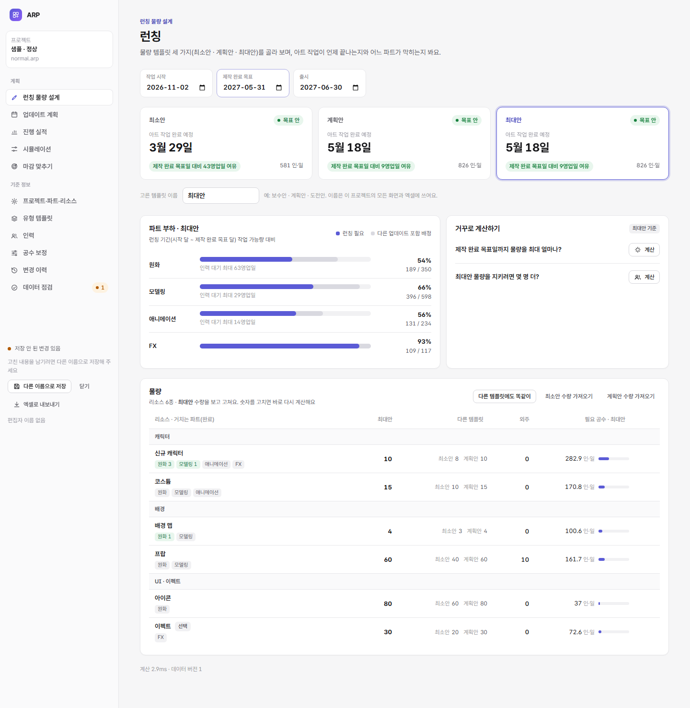
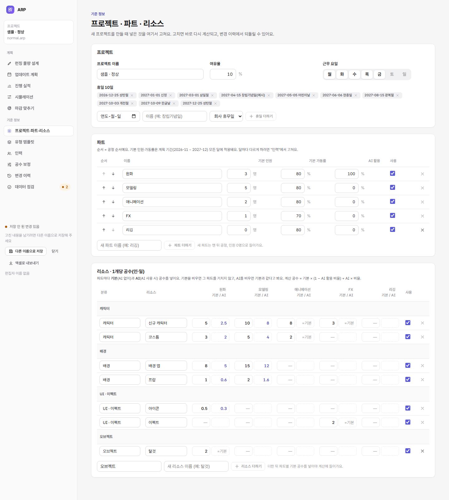

# 만든 뒤 고치기 · 물량 템플릿 · AI 공수 (2026-11-05)

사용자 요청 세 가지를 반영했다.
1. 프로젝트를 만든 뒤에도 파트별 가동률과 리소스(공수)를 고칠 수 있게
2. 런칭의 세 구간(최저·목표·확장)을 이름 붙은 **물량 템플릿**으로, 빠르게 보고 입력하게
3. 기준 공수에서 **AI를 쓸 때와 안 쓸 때**를 구분

## 1. 프로젝트 · 파트 · 리소스 (기준 정보 메뉴)

새 프로젝트 마법사에서 넣은 것을 모두 이 화면에서 고친다. 고치면 바로 다시 계산되고, 모든 고치기는 변경 이력에 남아 되돌릴 수 있다.

| 영역 | 고칠 수 있는 것 | 규칙 |
|---|---|---|
| 프로젝트 | 이름, 여유율, 근무 요일, 휴일 더하기·빼기 | 근무 요일은 하루 이상, 여유율 0~99% |
| 파트 | 이름, 순서(= 공정 순서), 사용 여부, 더하기, 지우기 | 쓰는 리소스가 있으면 사용 안 함·지우기를 막는다(공수에서 먼저 뺀다). 진행 실적이 있으면 지우기를 막는다 |
| 파트 기본 인원·가동률 | 계획 기간 **모든 달에 한 번에** 적용 | 달마다 다르게 하려면 "인력" 화면. 화면에 보이는 값은 기간 안에서 가장 흔한 값 |
| 리소스 | 분류(새 분류는 자동 생성), 이름, 사용 여부, 더하기, 지우기 | 물량·유형 템플릿·실적에 쓰이면 지우기를 막는다 |
| 공수 | 리소스 × 파트마다 기본·AI 공수(인·일/개) | 기본을 비우면 그 파트를 거치지 않는다(실적이 있으면 막음). 0은 "거치지만 할 일 없음" |

지운 파트·리소스를 되돌리면 함께 지워진 인력 행·공수·거치는 파트도 돌아온다. 지운 ID는 다시 쓰지 않는다.

## 2. 물량 템플릿

- 엔진의 세 수량(`min_qty`·`target_qty`·`stretch_qty`)을 **템플릿 1·2·3**으로 부른다. 기본 이름은 **최소안 · 기본안 · 최대안**이고, 프로젝트마다 바꿀 수 있다(`meta.mode_name_MIN` …). 바꾼 이름은 모든 화면, 엑셀 내보내기, 변경 이력, 마감 맞추기 설명에 쓰인다.
- **런칭 화면:** 위쪽 템플릿 탭 3개에 템플릿마다 완료 예정과 판정이 나온다. 탭을 고르면 물량 표에 **그 템플릿의 수량 한 칸**만 크게 나와 바로 입력한다. 다른 두 템플릿의 수량은 옆에 흐리게 보인다.
- **빠른 입력:** "다른 템플릿에도 똑같이"는 지금 템플릿의 수량을 나머지 둘에 넣는다. "○○ 수량 가져오기"는 다른 템플릿의 수량을 지금 템플릿으로 가져온다. 둘 다 한 묶음이라 되돌릴 수 있다. 업데이트 계획의 상세 패널에도 같은 버튼이 있다.
- **계산이 막혀도**(수량 빈칸) 템플릿 전환 버튼이 나와 다른 템플릿으로 넘어가 채울 수 있다.
- **검증:** 빈칸(V01)은 계속 오류다. 순서(템플릿1 ≤ 2 ≤ 3, V02)는 **주의**로 낮췄다. 템플릿은 이름 붙은 수량 묶음이라 일부러 다르게 둘 수 있어서다.

## 3. AI 공수

```
계산에 쓰는 공수 = 기본 공수 × (1 − AI 활용 비율) + AI 사용 시 공수 × AI 활용 비율
```

- **리소스 × 파트:** "기본"(AI 없이)과 "AI"(AI 사용 시) 두 칸. AI를 비우면 기본과 같다고 본다.
- **파트:** "AI 활용" 비율(0~100%). 그 파트 작업 중 AI 공수로 계산하는 몫이다. 0이면 기본 공수만 쓴다.
- 엔진·파일 구조는 원래 있던 공수 프로필(`BASE`·`AI`)과 파트별 섞는 비율(`effort_mix`)을 그대로 쓴다. 새로 넣은 것은 고치는 화면과 고치기(`aiShare`)다.
- **시뮬레이션:** "AI 비율" 동작으로 원본을 바꾸지 않고 "AI를 더 쓰면?"을 비교할 수 있다. 공수 보정은 실투입과 섞인 공수를 비교한다.
- **예(크롬 시험):** 신규 캐릭터 원화의 AI 공수를 기본의 절반으로 두고 원화 AI 활용을 100%로 하면, 런칭의 신규 캐릭터 필요 공수가 282.9 → 268.1 인·일로 준다.

## 검사

| 종류 | 개수 | 내용 |
|---|---|---|
| [test/setup.test.mjs](../test/setup.test.mjs) | 7 | 템플릿 이름(같은 이름 거절·엑셀·되돌리기), 템플릿 복사, 프로젝트 설정·휴일, 파트(만들기·순서·사용·지우기·되돌리기), 기본 인원·가동률, 리소스·공수(거치는 파트 생김·빼기·지우기·되돌리기), AI 활용 비율(0·50·100%) |
| [tools/e2e-setup.mjs](../tools/e2e-setup.mjs) | 11 | 템플릿 탭·한 칸 입력·이름 바꾸기·수량 가져오기, 파트·리소스 화면, AI로 필요 공수가 주는지, 변경 이력 |




