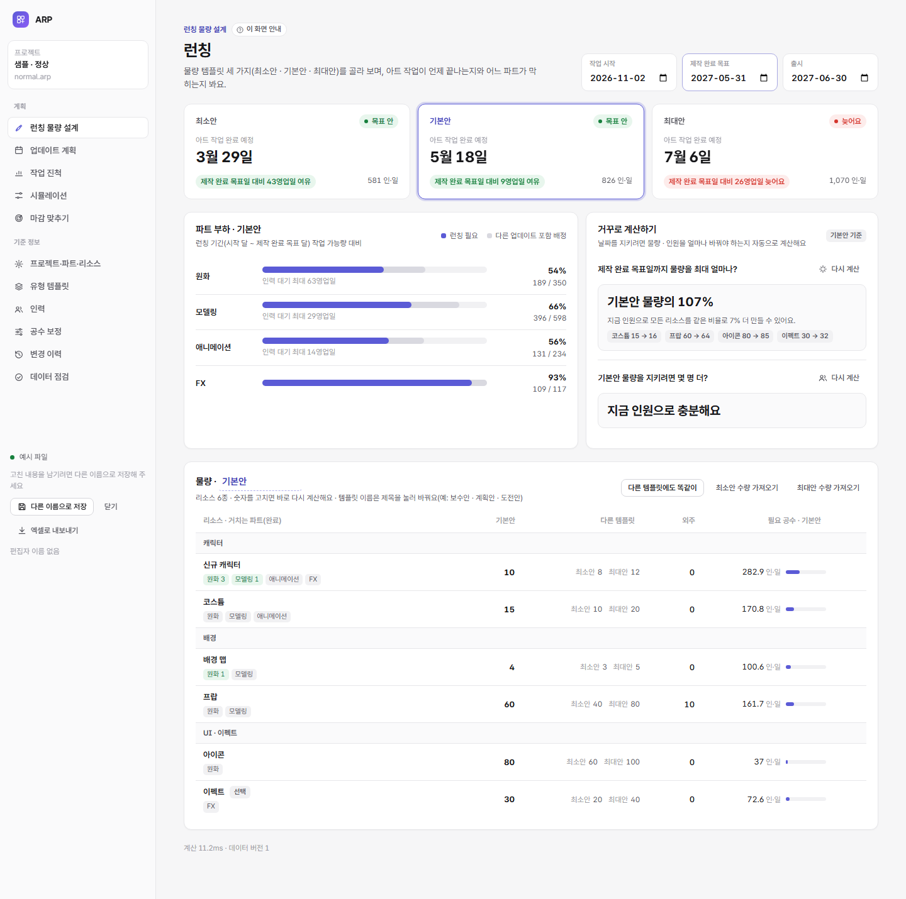
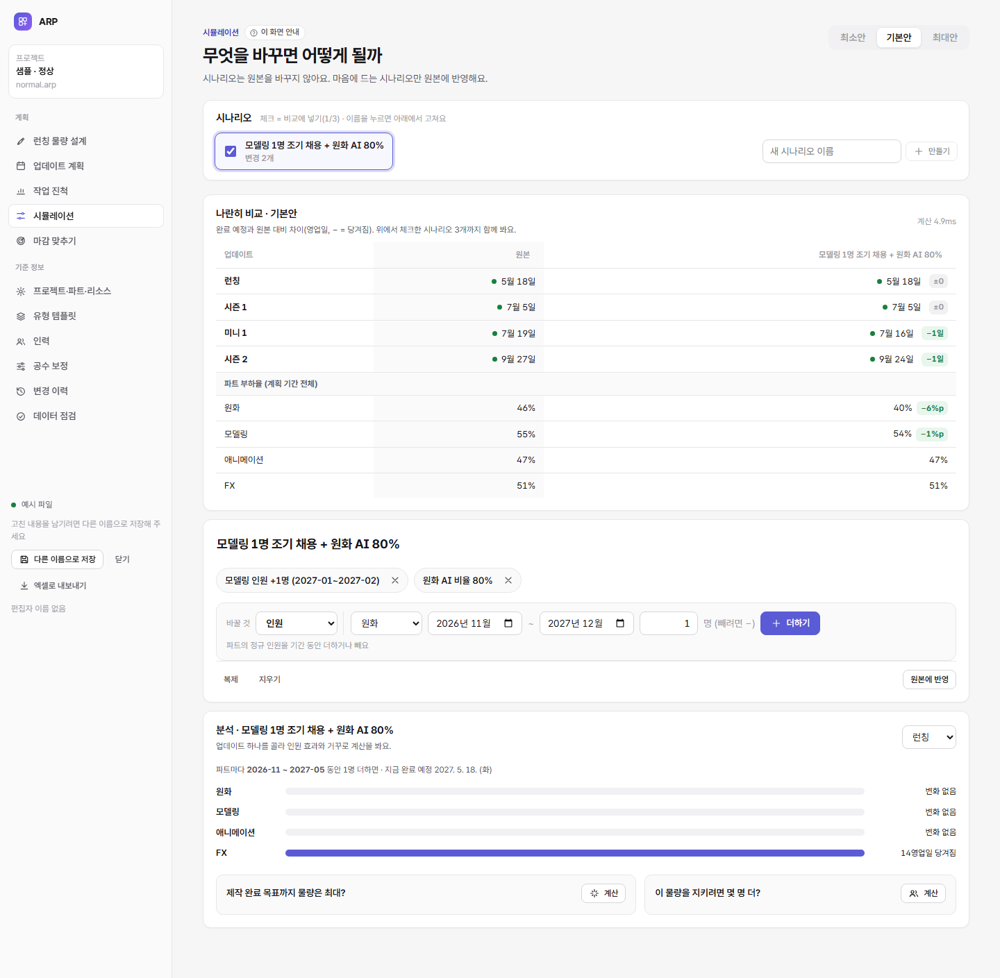
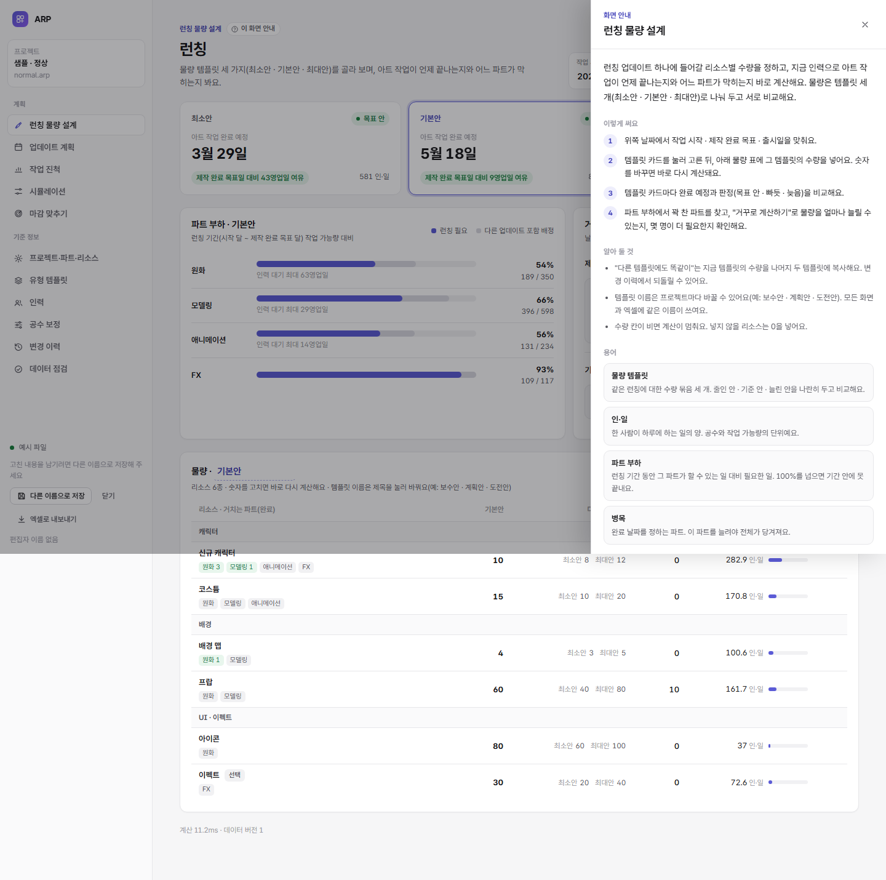

# 화면 배치 점검 · 화면 안내 · 용어 (2026-11-06)

요청 세 가지를 반영했다.
1. 공간을 못 쓰는 배치를 모든 화면에서 찾아 고친다(예: 시뮬레이션 동작 입력이 탭 한 줄 + 입력 한 줄로 갈라지고 오른쪽이 빔)
2. "진행 실적"은 뜻이 흐리다 → 더 쉬운 말로
3. 주메뉴마다 자세한 설명을 볼 수 있게

## 1. 배치 점검

모든 메뉴를 1440px · 390px로 찍어 비교했다([tools/capture-pages.mjs](../tools/capture-pages.mjs)). 좁은 화면에서 가로로 넘치는 요소는 [tools/find-overflow.mjs](../tools/find-overflow.mjs)로 찾는다.

| 화면 | 문제 | 고친 것 |
|---|---|---|
| 시뮬레이션 | 왼쪽 열에 시나리오 목록만 있어 아래가 비고, 오른쪽 내용은 좁아짐. 동작 입력은 종류 탭(9개) 한 줄 + 입력 한 줄로 갈라지고 오른쪽이 빔 | 시나리오를 **위쪽 가로 줄**(체크 = 비교에 넣기, 누르면 고치기, 오른쪽 끝에 새로 만들기)로 올리고 아래 카드를 모두 전체 폭으로. 동작 입력은 **"바꿀 것" 목록 + 값 + 더하기를 한 줄**로, 아래에 고른 동작의 한 줄 설명. 쌓인 동작은 줄 대신 **칩**으로 |
| 런칭 물량 설계 | 날짜 칩이 머리말 아래 따로 한 줄. 템플릿 이름 칸이 또 한 줄. "거꾸로 계산하기" 카드는 계산 버튼을 누르기 전까지 거의 비어 있음 | 머리말 글을 줄여 날짜가 **머리말 오른쪽**에 남게(모든 화면 공통). 템플릿 이름은 **물량 표 제목에서 바로** 고침. 거꾸로 계산은 물량·날짜·템플릿이 바뀌면 **잠시 뒤 자동 계산**(실데이터 16~32ms, 현실 규모 샘플 113ms) |
| 유형 템플릿 | 왼쪽 유형 목록 아래가 비고 표가 좁음 | 유형을 **위쪽 탭**으로, 새 유형 더하기는 탭 줄 오른쪽 끝. 표는 전체 폭 |
| 인력 | 14달 중 12달만 보이고 나머지는 가로 스크롤 | 칸 폭을 표 폭에 맞춰 **모든 달이 한 화면에**(달이 많으면 최소 폭만큼 스크롤) |
| 프로젝트·파트·리소스 | 파트 이름 칸이 지나치게 넓음. 리소스 표의 분류 칸이 넓어 공수 칸이 밀림 | 이름 · 분류 칸 폭을 정하고, 파트 표에 **거치는 리소스 수** 열을 더함 |
| 휴대폰 폭 | 위쪽 저장 줄의 "예시 파일"이 세로로 한 글자씩 꺾임 | 저장 줄이 줄바꿈되게 |

## 2. 용어: 진행 실적 → 작업 진척

"실적"은 성과 평가처럼 읽혀서, 하는 일(끝낸 수량 넣기 → 남은 일 다시 계산)이 드러나는 **작업 진척**으로 바꿨다.

- 메뉴 · 화면 · 안내 문구 · 오류 문구 · 변경 이력 표 이름 · 데이터 점검 규칙(A01~A03 분류) · 내보내기 엑셀 시트 이름 · 양식 파일 이름("○○ 작업 진척 양식.xlsx")
- 양식을 넣을 때 시트 이름은 **"작업 진척"과 옛 이름 "실적" 둘 다** 읽는다(이미 받아 둔 양식도 그대로 넣을 수 있음)
- "실투입 인·일"은 그대로 둔다(실제로 쓴 사람·일이라는 뜻이 분명)
- 점검 규칙 A02에 남아 있던 옛 용어 "확장"을 "템플릿3(세 번째 템플릿)"으로 바꿨다

## 3. 화면 안내

- 모든 주메뉴 머리말의 메뉴 이름 옆에 **"이 화면 안내"** 버튼. 누르거나 키보드 **?**(입력 칸 밖에서)를 누르면 오른쪽 패널이 열린다. Esc · 바깥 누르기로 닫는다.
- 패널: **무엇을 하는 곳 · 이렇게 써요(번호 단계) · 알아 둘 것 · 용어 · 함께 쓰는 화면**. "함께 쓰는 화면"을 누르면 그 화면으로 이동한다.
- 왼쪽 메뉴에 마우스를 올리면 한 줄 설명이 보인다.
- 템플릿 이름(최소안 · 기본안 · 최대안을 바꾼 이름)은 안내 글에도 그대로 쓰인다.
- 내용: [web/app/ui/Help.tsx](../web/app/ui/Help.tsx) `helpDoc()`

## 4. 문체: 해요체 → 합니다체 (2026-11-06 추가 요청)

설명 · 안내 · 알림 · 오류 문구를 건조한 설명문으로 바꿨다(예: "개수를 넣어요" → "개수를 입력합니다").

| 종류 | 규칙 | 예 |
|---|---|---|
| 설명 · 알림 | `~해요` → `~합니다`, `~예요/이에요` → `~입니다` | "바로 계산해요" → "바로 계산합니다" |
| 요청 | `~해 주세요` → `~하십시오` | "다른 이름으로 저장해 주세요" → "다른 이름으로 저장하십시오" |
| 확인 질문 | `~할까요?` → `~하시겠습니까?` | "지울까요?" → "삭제하시겠습니까?" |
| 낱말 | 넣다 → 입력하다 · 고치다 → 수정하다 · 지우다 → 삭제하다 · 바꾸다 → 변경하다 · 고르다 → 선택하다 · 쓰다 → 사용하다(문장 안 활용형만) | "고친 내용" → "수정한 내용" |
| 판정 배지 | 문장 대신 짧은 명사형 | 빠듯해요 → 빠듯 · 늦어요 → 늦음 · 기간 안에 못 끝나요 → 기간 안에 못 끝남 |

- 버튼 이름(더하기 · 지우기 · 되돌리기 등)은 그대로 둔다. 짧은 동작 이름이라 문체와 관계없다.
- 범위: 앱 화면 · 화면 안내 · 알림 · 오류 문구(엔진 메시지 포함) · 데이터 점검 규칙 · 가져오기 보고 · [사용 안내서](11-user-guide.md)
- 옛 용어 정리: 변경 이력의 수량 칸 이름(최저 · 목표 · 확장 → 최소안 · 기본안 · 최대안), 가져오기 보고와 진척 주의 문구의 "확장"

## 5. 화면 들썩임 없애기 · 물량 표 버튼 (2026-11-06 추가 요청)

템플릿 카드를 바꾸면 "거꾸로 계산하기"가 자동으로 다시 계산되는데, 그 사이 "변경되었습니다. 다시 계산하십시오." 문구가 0.46초쯤 나타났다 사라지며 카드가 22~44px 늘었다 줄었다. 템플릿마다 답의 줄 수도 달라 아래 물량 표가 위아래로 움직였다.

- **원칙:** 잠깐 나타나는 문구는 흐름 밖(겹쳐 표시)이나 미리 확보한 자리에만 둔다. 데이터에 따라 줄 수가 달라지는 칸은 높이를 미리 확보한다.
- **거꾸로 계산하기:** 진행 상태("계산 중…" · "계산하지 못했습니다")는 답 칸 오른쪽 위에 겹쳐 표시하고, 지난 답은 흐리게만 한다. 답 칸은 최소 높이를 확보하고(물량 136px · 인원 104px), 첫 계산 전에는 같은 높이의 빈 칸을 보여 준다. 버튼 글자는 "다시 계산"으로 고정한다. 휴대폰 폭에서는 변경 칩을 한 줄로 두고 가로로 밀어 본다(오른쪽 끝 흐림).
- **파트 부하:** "병목" 배지 자리를 늘 확보해(이름 칸 최소 46px) 템플릿을 바꿔도 행 높이가 같다.
- **측정:** 매 프레임 물량 표 위치·카드 높이를 기록. 고치기 전 22~96px 움직임 → 고친 뒤 보통·과부하·대규모 예시, 1440px·390px 모두 0px.
- **물량 표 복사 버튼:** 글자처럼 보이던 버튼을 "⧉ 수량 복사" 이름표 + 테두리가 이어진 버튼 묶음([최소안 → 기본안] [최대안 → 기본안] [기본안 → 최소안·최대안])으로 바꿨다. 휴대폰 폭에서는 버튼마다 떨어져 줄바꿈된다. 업데이트 상세 패널도 같은 표를 쓴다.

## 검사

- `npm test` 106개 통과(문구 바뀐 검사 3개 고침)
- `npm run e2e` 115개 통과: 만든 뒤 고치기 시험에 화면 안내 2개 추가(패널 열기 · 함께 쓰는 화면으로 이동 · 메뉴 이름 "작업 진척"). 시뮬레이션 시험은 "바꿀 것" 목록으로 동작을 고르게 고침
- 390px에서 모든 메뉴 가로 넘침 없음(업데이트 계획 타임라인은 카드 안에서 가로 스크롤)
