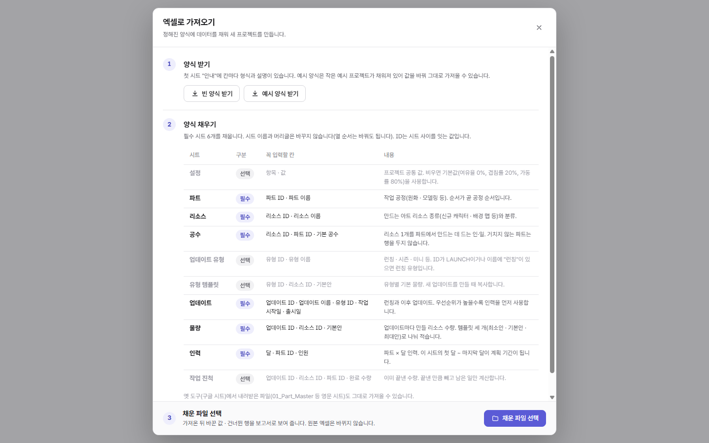

# 엑셀 가져오기 양식 (2026-11-06)

**요청:** 엑셀 가져오기를 쓰려면 정해진 규격(엑셀 양식)을 사용자에게 먼저 제공해야 한다.

## 사용자 흐름

시작 화면 **엑셀로 가져오기**를 누르면 바로 파일을 고르지 않고 창이 열린다.

| 단계 | 내용 |
|---|---|
| 1. 양식 받기 | **빈 양식** · **예시 양식**(작은 예시 프로젝트: 파트 3 · 리소스 4 · 업데이트 2, 날짜는 받는 날 기준 다음 달부터) |
| 2. 양식 채우기 | 창 안의 규격 표: 시트 / 필수 · 선택 / 꼭 입력할 칸 / 내용 |
| 3. 채운 파일 선택 | 창 아래에 고정. 가져오기에 실패하면(예: 필수 시트 없음) 오류를 알리고 창을 다시 연다 |

## 양식 파일

| 시트 | 내용 |
|---|---|
| `안내` | 사용 방법 · 공통 규칙(ID · 날짜 · 비율 · 사용 여부) · 시트별 칸 사전(칸 / 필수 / 형식 / 설명) |
| 필수 6개 | 파트 · 리소스 · 공수 · 업데이트 · 물량 · 인력 |
| 선택 4개 | 설정 · 업데이트 유형 · 유형 템플릿 · 작업 진척 |

- 1행 머리글은 한글. 필수 칸은 진한 색에 `*`, 선택 칸은 회색.
- 2행은 회색 설명 줄(첫 칸이 `※`). 가져올 때 읽지 않는다. 1~2행은 고정.
- 열 순서는 바꿔도 된다(머리글 이름으로 찾는다).

## 규격은 한 곳에서: [core/import-spec.ts](../core/import-spec.ts)

`IMPORT_SPEC`(시트 · 칸 · 필수 · 형식 · 설명)으로 아래를 모두 만든다. 규격을 바꾸면 양식 · 화면 · 가져오기가 함께 바뀐다.

| 쓰는 곳 | 함수 |
|---|---|
| 양식 파일(빈 · 예시) | `templateBook()` |
| 가져오기 전 바꾸기: 한글 시트 · 머리글 → 옛 도구 구조 | `normalizeSheets()` (가져오기 본체 `legacyToRows` 첫 줄에서 부른다) |
| 가져오기 창의 규격 표 | `specSummary()` |
| 필수 시트가 없을 때 오류 문구(한글 이름) | `missingSheetNames()` |

### 읽는 규칙

| 항목 | 한글 양식 | 옛 도구 시트 |
|---|---|---|
| 시트 이름 | `파트`, `01 파트`도 읽음 | `01_Part_Master` |
| 머리글 | `파트 ID`(끝 `*`, 띄어쓰기 무시) | `PART_ID` |
| 비율(가동률 · 재사용률 · 재작업률 · 설정의 여유율 · 겹침률) | `80%`, `80`, `0.8` 모두 0.8 | 그대로 |
| 사용 여부 | Y/N, O/X, 사용/미사용 | 옛 규칙(TRUE · Y · YES · 1만 사용) |
| 우선순위 | 높음 · 보통 · 낮음(상 · 중 · 하) 또는 숫자 | HIGH · MEDIUM · LOW |
| 리소스 분류 | `분류` 칸 하나 → 분류(G01…)를 만들고 묶음 | GROUP 행 + 부모 ID |
| 설정 항목 | 여유율 · 기본 겹침률 · 기본 가동률 · 기본 생산성 · `겹침률:앞파트ID>뒤파트ID` | 영문 키 |

- **옛 도구 시트는 값까지 그대로 둔다.** 옛 계산 대조(`compare-legacy --check`)가 같아야 해서, 넓힌 값 규칙은 한글 머리글로 찾은 칸에만 쓴다.
- 한글 양식으로 가져오면 옛 도구 전용 보고 문구(BUSINESS_DAYS · HIGH/MEDIUM/LOW 등급 · SHOULD/COULD)는 내지 않는다.
- 엑셀 쓰기([core/xlsx-write.ts](../core/xlsx-write.ts))에 양식용 칸 꾸밈(필수 · 선택 머리글, 회색 설명, 제목)과 시트별 고정 행 수를 더했다.

## 검사

| 종류 | 개수 | 내용 |
|---|---|---|
| [test/import-template.test.mjs](../test/import-template.test.mjs) | 4 | 빈 양식 구조 · 예시 양식을 그대로 가져와 오류 없이 계산 · 한글/영문 섞어 쓰기 · 옛 시트는 값까지 그대로 |
| [tools/e2e-import.mjs](../tools/e2e-import.mjs) | +2 | 가져오기 창(단계 · 규격 표 10행 · 필수 6) · 예시 양식 받기 |

## 다음에 할 만한 것

- **지금 프로젝트를 양식으로 내보내기:** 연 프로젝트를 같은 양식 구조로 내보내 엑셀에서 대량 수정 → 다시 가져오기(왕복). 지금의 "엑셀로 내보내기"는 보고용이라 다시 가져올 수 없다.
